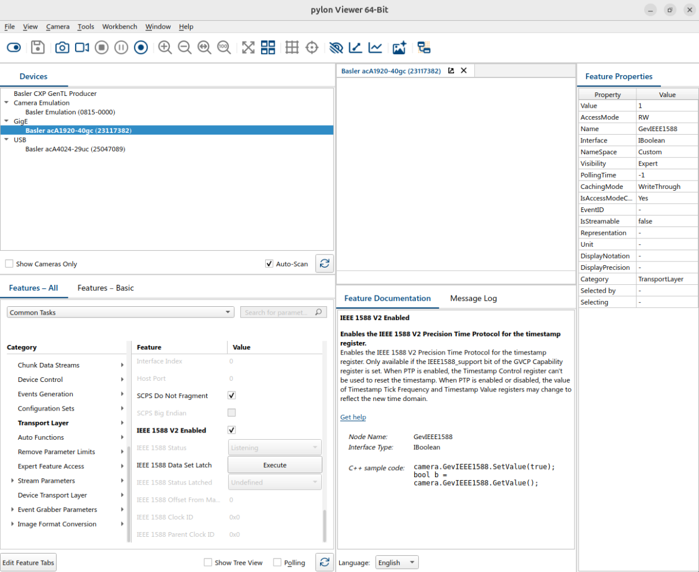

<!--hide_directive
```{eval-rst}
.. meta::
   :description: Configure a Basler camera to embed a hardware Precision Time Protocol (PTP) timestamp in every frame using the pylon Viewer.
   :keywords: Basler, PTP, hardware timestamps, pylon Viewer, IEEE 1588v2, VLAN 3
```
hide_directive-->

# Configure the Basler Camera to Use Precision Time Protocol (PTP) Timestamps

This guide explains how to configure a Basler camera so that it embeds a hardware PTP timestamp
in every frame. These timestamps provide the capture time with sub-microsecond accuracy.
Configure each camera only once, using the pylon Viewer on any computer.

## Prerequisites

- The switch and machine-1 use [IEEE 1588v2](../moxa/configure-ptp-1588v2.md).
- The camera is cabled to a switch port in VLAN 3 (ports 5 and 6 in this demonstration).
- The Basler pylon Viewer is [installed](https://www.baslerweb.com/en/downloads/software/).

## Steps

1. **Set a static IP address.** In the pylon IP Configurator (**Tools > pylon IP Configurator**),
   assign an address in the VLAN 3 subnet: `192.168.3.17` and `192.168.3.18` in this demonstration.
2. **Enable PTP.** In the **PTP** feature group, enable PTP so that the timestamps come from the PTP clock.

   

3. **Match the switch profile:**

   | Parameter       | Value                  |
   | --------------- | ---------------------- |
   | Profile         | 1588v2 Default Profile |
   | Clock type      | Boundary clock         |
   | Delay mechanism | End-to-End             |
   | Transport mode  | UDP IPv4               |
   | Domain number   | 0                      |
   | Priority 1 / 2  | 64 / 128               |

## Verify

The **IEEE 1588 Parent Clock ID** in the PTP group must equal the switch's clock ID (its MAC address).
