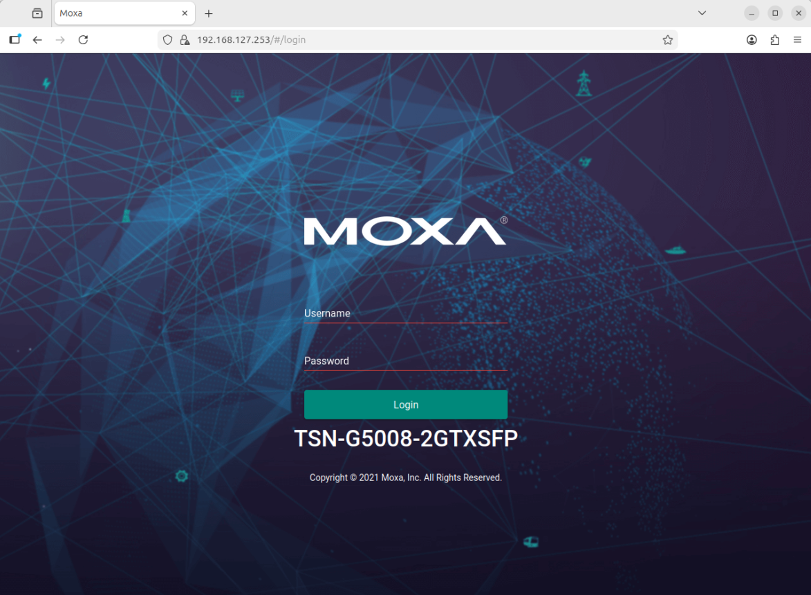

<!--hide_directive
```{eval-rst}
.. meta::
   :description: Configure the Moxa TSN-G5000 switch as the Precision Time Protocol (PTP) grandmaster, with VLANs and the IEEE 802.1Qbv Time-Aware Shaper.
   :keywords: Moxa TSN-G5000, Time-Sensitive Networking, TSN, PTP, VLAN, Qbv, Time-Aware Shaper, Telnet
```
hide_directive-->

# Configure the Moxa Time-Sensitive Networking (TSN) Switch

This guide explains how to configure the Moxa TSN-G5000 switch, which is the network fabric of
this demonstration. The switch acts as the Precision Time Protocol (PTP) grandmaster, separates
the traffic into VLANs, and runs the IEEE 802.1Qbv Time-Aware Shaper (Qbv).

> [!NOTE]
> This is a reference guide for changing the switch. For a normal installation, follow
> [First-time setup](../../first-time-setup.md).

## Access the Web Interface

After a reset, the switch has the address `192.168.127.253`, the user `admin`, and the password `moxa`.
Put your computer in the same subnet (for example `192.168.127.100/24`) and open the address in a
browser. These defaults are publicly known, so keep the switch on an isolated network.



## Switch Configuration Requirements

| Setting           | Value                                                                                                            | Guide                                                                |
| ----------------- | ---------------------------------------------------------------------------------------------------------------- | -------------------------------------------------------------------- |
| VLANs 1, 3, and 5 | Tagged on ports 1 to 4                                                                                           | [VLAN](./configure-vlan-on-moxa-switch.md)                           |
| PTP profile       | 1588v2 default, or 802.1AS                                                                                       | [1588v2](./configure-ptp-1588v2.md), [gPTP](./configure-ptp-gptp.md) |
| Time-Aware Shaper | Schedule Gate on for port 1                                                                                      | [Qbv](./enable-tsn-traffic-shaping.md)                               |
| Management        | Telnet enabled (the dashboard scripts use it); management stays on VLAN 1 and on a port the shaper never touches |                                                                      |

## Scripts

The scripts in `src/switch/` drive the switch over Telnet. The dashboard runs them on machine-2, where
`make -C src/dashboard deploy-switch` copies them to `~/moxa`:

| Script                                            | Purpose                                                                                               |
| ------------------------------------------------- | ----------------------------------------------------------------------------------------------------- |
| `tas_config.py get\|set\|clear --port N`          | Qbv gate schedule                                                                                     |
| `port_priority.py get\|set --ports 5,6 --value 0` | Default priority of untagged frames on the given ports (needs `--host <switch address>`)              |
| `get_port_mode.py --port N`                       | Link state and mode of a port                                                                         |
| `ptp_profile.py get\|1588v2\|802.1as`             | PTP profile. Not copied by `deploy-switch`: copy it to machine-2 yourself. `--help` lists its options |

The scripts refuse port 2 (the management path of machine-2).

## Further Reading

[Moxa TSN-G5000 Series User Manual](https://www.moxa.com/getmedia/a0db0ef9-2741-4bad-91c6-1ec1827aca64/moxa-tsn-g5000-series-web-console-manual-v2.3.pdf)
