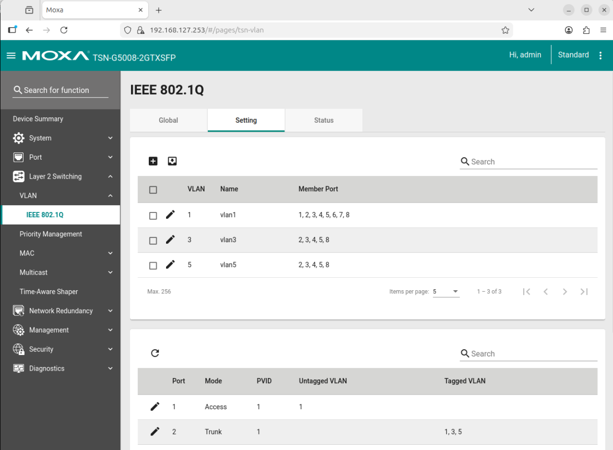
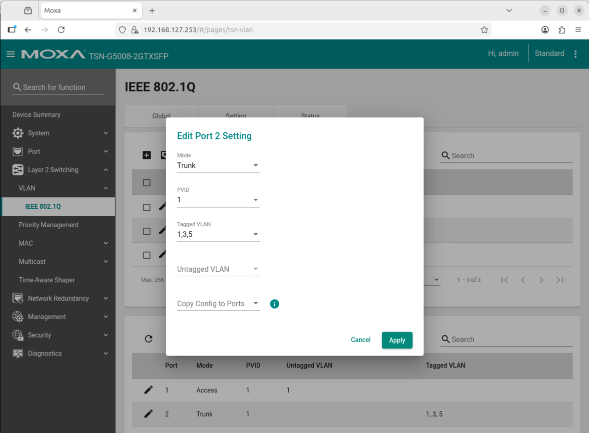

<!--hide_directive
```{eval-rst}
.. meta::
   :description: Create VLANs on the Moxa switch and assign them to the ports that the machines and cameras use.
   :keywords: Moxa, VLAN, IEEE 802.1Q, tagged ports, PVID, Basler
```
hide_directive-->

# Configure VLANs on the Moxa Switch

This guide explains how to create VLANs on the Moxa switch and assign them to the ports that your machines and cameras use.

## Prerequisites

The switch is reachable as described in [Configure the Moxa TSN switch](./configure-moxa-switch.md).

## Configure the VLANs

Identify the switch port for each connected machine. Then configure each port to handle tagged
VLAN traffic for the VLAN IDs that the connected machine requires.

> [!NOTE]
> In this demonstration, ports 1 to 4 (machines 1 to 4) carry VLANs 1, 3, and 5 tagged.
> Ports 5 and 6 (Basler cameras) are untagged members of VLAN 3 with Port VLAN ID (PVID) 3.

1. Open the Moxa switch web interface by entering the switch's IP address (`192.168.127.253`
   after a reset) in a web browser.
2. Log in (after a reset: user `admin`, password `moxa`).
3. Navigate to **VLAN > IEEE 802.1Q** in the menu.
4. Create VLANs with IDs 1, 3, and 5 if they do not already exist.

   

5. Assign the appropriate ports to the VLANs as tagged ports by clicking the edit icon (🖉) of
   the port.

   

6. Apply the configuration and reboot the switch if necessary.
7. Check the port settings to verify that the correct VLANs are assigned.

## Further Reading

[Moxa TSN-G5000 Series User Manual](https://www.moxa.com/getmedia/a0db0ef9-2741-4bad-91c6-1ec1827aca64/moxa-tsn-g5000-series-web-console-manual-v2.3.pdf)