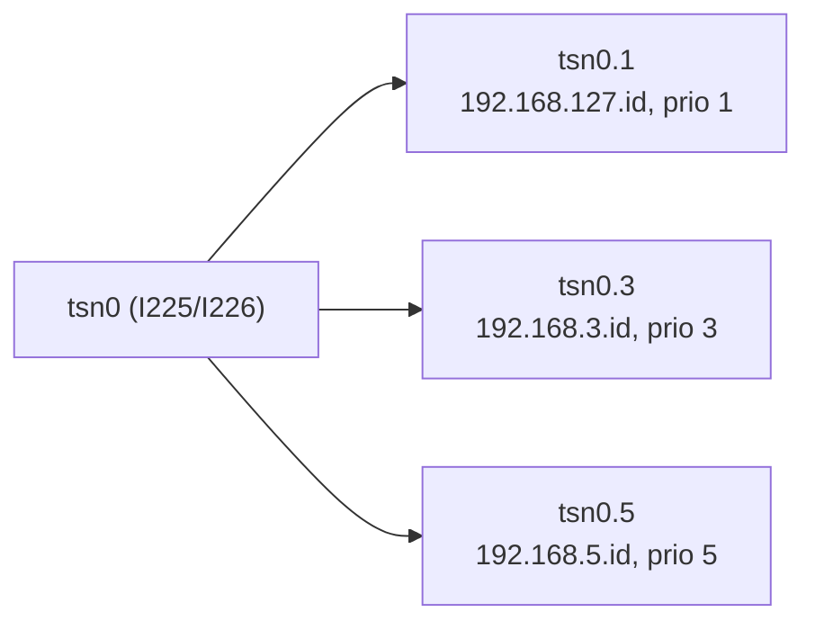

<!--hide_directive
```{eval-rst}
.. meta::
   :description: Complete the one-time setup of SSH, Docker, NIC and VLANs, Precision Time Protocol (PTP), switch VLANs, the Time-Aware Shaper, and the lab configuration.
   :keywords: first-time setup, SSH, Docker, NIC, VLAN, PTP, Time-Aware Shaper, lab.env, Basler
```
hide_directive-->

# First-Time Setup

This guide covers the steps that you run **once** per machine or on the switch. Afterward, you
need only `make up` and `make down` from [Get started](./get-started.md). Do the steps in order:
run steps 1 to 3 on every machine, steps 4 and 5 on the switch, and step 6 on machine-1.

Work on machine-1, in a clone of this repository, as described in
[Get started](./get-started.md#clone-the-project).
The scripts in `src/setup/` exist only there. Run them directly on machine-1. For machines 2
to 4, copy them over with `scp` and run them with `ssh -t`. The `-t` option lets `sudo` ask
for the password. In the commands below, `<user>` is your user name on the machines and
`<machine-N lab address>` is the address of machine N on the normal lab network, not a
Time-Sensitive Networking (TSN) address.

## 1. SSH and Docker (Every Machine)

Machine-1 must reach machines 2 to 4 without a password, and your user must be allowed to run Docker:

```bash
ssh-keygen -t ed25519                           # only if you have no ssh key yet
ssh-copy-id <user>@<machine-2 lab address>      # repeat for machines 3 and 4
ssh <user>@<machine-2 lab address> docker ps    # check: no password prompt, no "permission denied"
```

If `docker ps` is denied, add the user to the `docker` group on that machine and log in again.
Run the first command on machine-1 and the second one for each of machines 2 to 4:

```bash
sudo usermod -aG docker <user>                                   # machine-1
ssh -t <user>@<machine-2 lab address> 'sudo usermod -aG docker <user>'   # machines 2 to 4
```

Docker Engine with Compose V2 must already be installed
([install guide](https://docs.docker.com/engine/install/ubuntu/)).

## 2. NIC and VLANs (Every Machine)



The `setup_tsn_nic.sh` script names the TSN NIC `tsn0`, creates `tsn0.1`, `tsn0.3`, and
`tsn0.5`, and sets the priority maps (VLANs 1, 3, and 5 become frame priorities 1, 3, and 5).
`--id` is the last address octet: 11, 12, 13, and 14 for machines 1 to 4. The script stops if
the machine has no supported TSN NIC or more than one.

```bash
sudo src/setup/setup_tsn_nic.sh --id 11 --persist        # machine-1
scp src/setup/setup_tsn_nic.sh <user>@<machine-2 lab address>:/tmp/
ssh -t <user>@<machine-2 lab address> 'sudo bash /tmp/setup_tsn_nic.sh --id 12 --persist'   # machines 3, 4: --id 13, 14
```

Reboot each machine afterward (`sudo reboot`), because the NIC rename takes effect at the next boot.

Verify that `ip -d link show tsn0.1 | grep egress_qos` lists eight mappings. The script also offers `--qos`
(reapply the priority maps only, without an interface reset), `--find` (show the detected NIC), and `--uninstall`.
Manual commands: [Create VLANs on all machines](./how-to-guides/moxa/create-vlan-on-all-machines.md).

## 3. PTP (Every Machine)

The `ptp-install.sh` script installs `linuxptp`, the `ptp4l` and `phc2sys` services, and the
`ptp-profile` command, and disables NTP clients. The switch is the grandmaster; the machines
are slaves.

```bash
sudo src/setup/ptp-install.sh               # machine-1; default profile: IEEE 1588v2
scp src/setup/ptp-install.sh <user>@<machine-2 lab address>:/tmp/
ssh -t <user>@<machine-2 lab address> 'sudo bash /tmp/ptp-install.sh'          # machines 2 to 4
sudo ptp-profile status                     # check, on each machine: offset well below 1 µs
```

To use IEEE 802.1AS, run `sudo ptp-profile gptp`. The switch and every machine must use the same
profile, so set it on the switch as well, in the web interface under
System > Time > Time Synchronization. For instructions, see
[1588v2](./how-to-guides/moxa/configure-ptp-1588v2.md) and
[gPTP](./how-to-guides/moxa/configure-ptp-gptp.md). The machines lock only after the switch
sends PTP, so run `sudo ptp-profile status` again after step 4.

## 4. Switch VLANs

Open the switch web interface in a browser. After a reset, the switch address is `192.168.127.253`, the user is `admin`,
and the password is `moxa`. Give your computer an address in `192.168.127.0/24`, for example `192.168.127.100`.
Create VLANs 1, 3, and 5 and make ports 1 to 4 **tagged** members. For Basler cameras, also configure
ports 5 and 6. For details, see
[Configure VLANs on the Moxa switch](./how-to-guides/moxa/configure-vlan-on-moxa-switch.md).
Check: from machine-1, `ping 192.168.127.12` reaches machine-2 over VLAN 1.

## 5. Switch Time-Aware Shaper

In the switch web interface, turn on **Schedule Gate** for port 1 (Layer 2 Switching > Time-aware
Shaper). The dashboard then adds and removes the schedule. For details, see
[Enable TSN traffic shaping](./how-to-guides/moxa/enable-tsn-traffic-shaping.md).
Check: once the dashboard runs, its Qbv toggle is enabled and shows no warning banner.

## 6. Lab Configuration (Machine-1)

`lab.env` holds all addresses and is excluded from Git. Fill in every line. The comments in the
file explain each entry:

| Entry                        | Value                                                                 |
| ---------------------------- | --------------------------------------------------------------------- |
| `SSH_USER`                   | the user name `<user>` used above (the same on all four machines)     |
| `M1_LAB_IP` ... `M4_LAB_IP`  | lab-network addresses of the four machines                            |
| `M1_TSN_IP` ... `M3_TSN_IP`  | VLAN 1 addresses, `192.168.127.11` to `.13` if you used the IDs above |
| `M1_NOISE_IP`, `M4_NOISE_IP` | VLAN 5 addresses, `192.168.5.11` and `192.168.5.14`                   |
| `SWITCH_IP`                  | switch management address, `192.168.127.253` after a reset            |

```bash
cp lab.env.example lab.env
make -C src/dashboard deploy-switch SWITCH_HOST=<user>@<machine-2 lab address>
```

The switch scripts run from machine-2, so the switch is never reached over the shaped port.
`deploy-switch` copies them to `~/moxa` on machine-2.

The first `make up` creates `src/dashboard/.env`. To let the dashboard toggle Qbv, set
`SWITCH_ALLOW_WRITE=1` in that file and run `make up` again (the default is read-only).

## Basler Cameras Only

Configuring camera PTP, setting the switch port priority, and building the Basler-enabled
pipeline server image are also one-time steps. For details, see
[Integrate Basler cameras with Scenescape](./how-to-guides/basler/integrate-basler-camera-with-scenescape.md).
