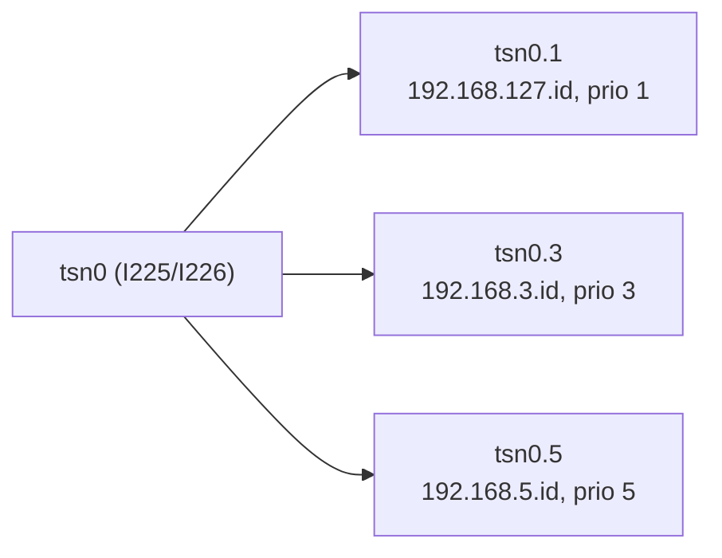

# First-Time Setup

Everything you run **once** per machine or switch. After this, only `make up` / `make down`
from [Get started](./get-started.md) is needed. Steps 1 to 3 run on every machine, 4 and 5 on
the switch, 6 on machine-1.

## 1. NIC and VLANs (every machine)



Names the TSN NIC `tsn0`, creates `tsn0.1`, `tsn0.3`, `tsn0.5` and sets the priority maps
(VLAN 1/3/5 become frame priority 1/3/5). `--id` is the last address octet: 11, 12, 13, 14 for
machines 1 to 4. Reboot afterwards.

```bash
sudo src/setup/setup_tsn_nic.sh --id 11 --persist
```

Check: `ip -d link show tsn0.1 | grep egress_qos` lists eight mappings. Priority maps only
(no interface reset), `--find` (show the detected NIC) and `--uninstall` are also available.
Manual commands: [Create VLANs on all machines](./how-to-guides/moxa/create-vlan-on-all-machines.md).

## 2. PTP (every machine)

Installs `linuxptp`, the `ptp4l`/`phc2sys` services and the `ptp-profile` command, and disables
NTP clients. The switch is the grandmaster, the machines are slaves.

```bash
sudo src/setup/ptp-install.sh               # default profile: IEEE 1588v2
sudo ptp-profile status                     # offset well below 1 us
```

Use `sudo ptp-profile gptp` for IEEE 802.1AS. The switch and every machine must use the same
profile: [1588v2](./how-to-guides/moxa/configure-ptp-1588v2.md),
[gPTP](./how-to-guides/moxa/configure-ptp-gptp.md).

## 3. ssh and Docker (machine-1 to the others)

```bash
ssh-copy-id <user>@<machine-2 lab address>      # also machines 3 and 4
sudo usermod -aG docker <user>                  # on every machine, then log in again
```

## 4. Switch VLANs

In the switch web page create VLANs 1, 3, 5 and make ports 1 to 4 members (ports 5 and 6 for
Basler). See [Configure VLAN on the Moxa switch](./how-to-guides/moxa/configure-vlan-on-moxa-switch.md).

## 5. Switch Time-Aware Shaper

In the switch web page turn on **Schedule Gate** for port 1 (Layer 2 Switching > Time-aware
Shaper). The dashboard then adds and removes the schedule. See
[Enable TSN traffic shaping](./how-to-guides/moxa/enable-tsn-traffic-shaping.md).

## 6. Lab configuration (machine-1)

`lab.env` holds all addresses and stays out of git.

```bash
cp lab.env.example lab.env      # user, lab and TSN addresses, switch address
make -C src/dashboard deploy-switch SWITCH_HOST=<user>@<machine-2 lab address>
```

The switch scripts run from machine-2, so the switch is never reached over the shaped port.
To let the dashboard toggle Qbv set `SWITCH_ALLOW_WRITE=1` in `src/dashboard/.env`
(created by the first `make up`; default is read-only).

## Basler only

Camera PTP and the switch port priority are one-time steps too:
[Integrate Basler cameras with SceneScape](./how-to-guides/basler/integrate-basler-camera-with-scenescape.md).
