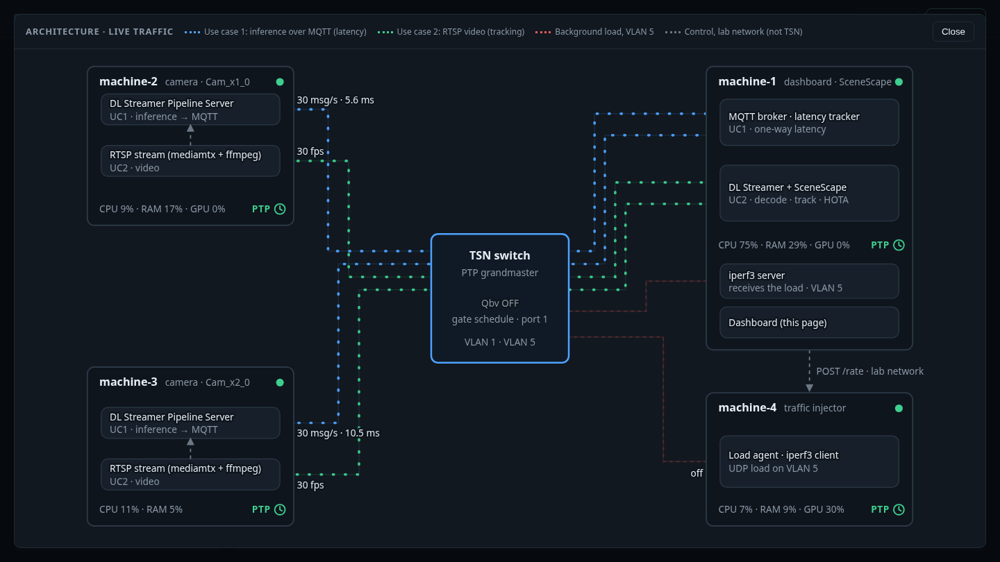
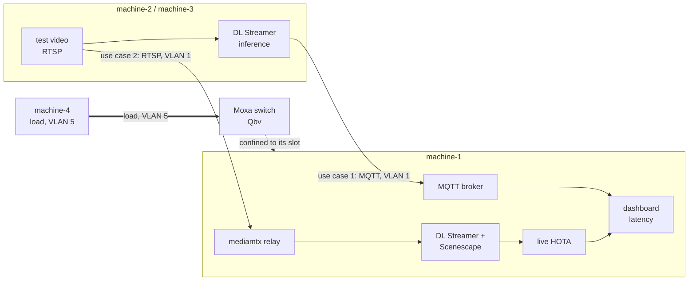
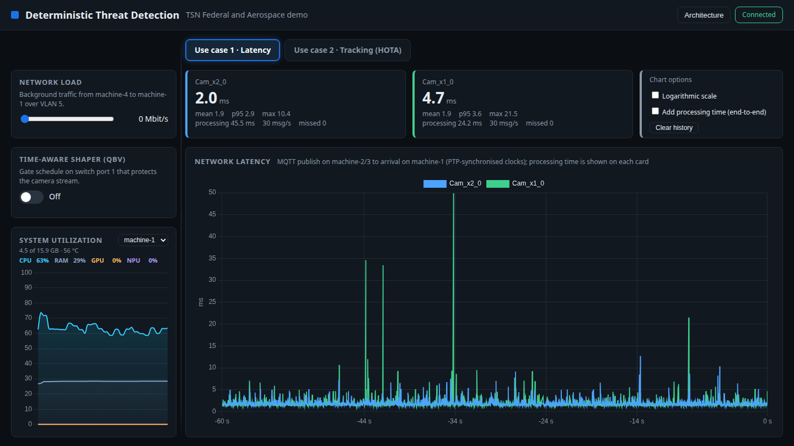
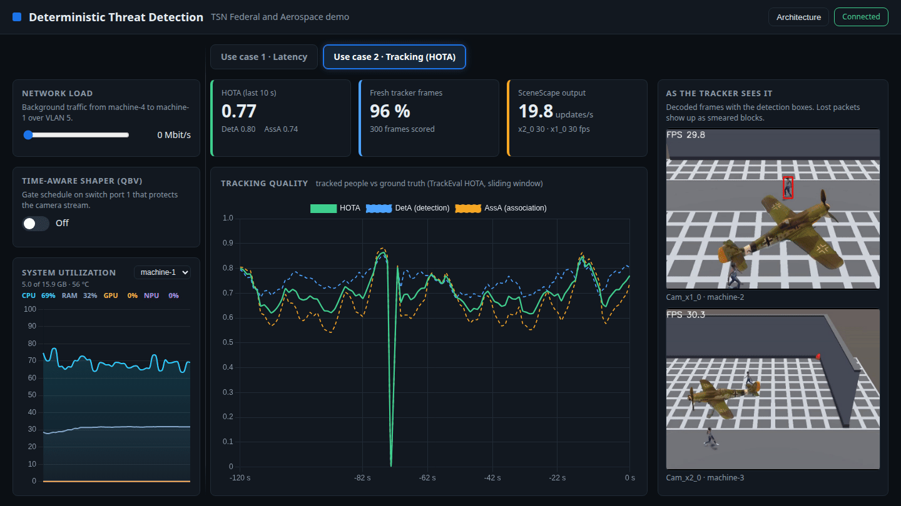
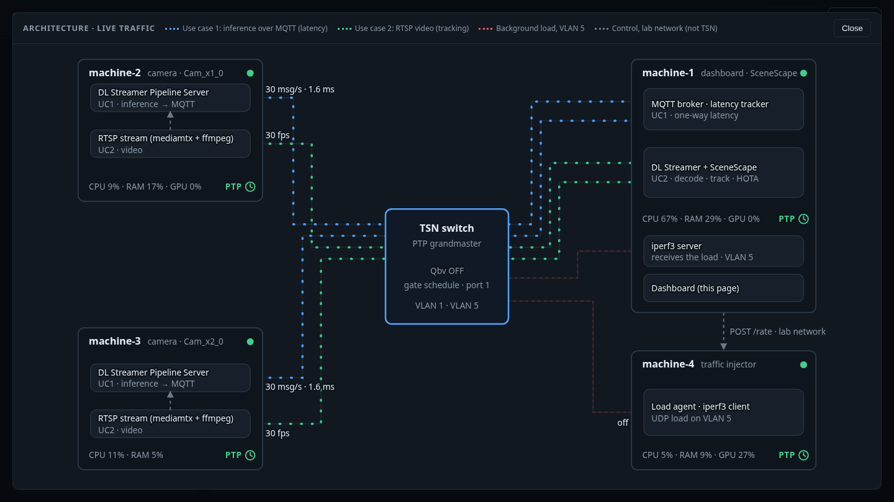
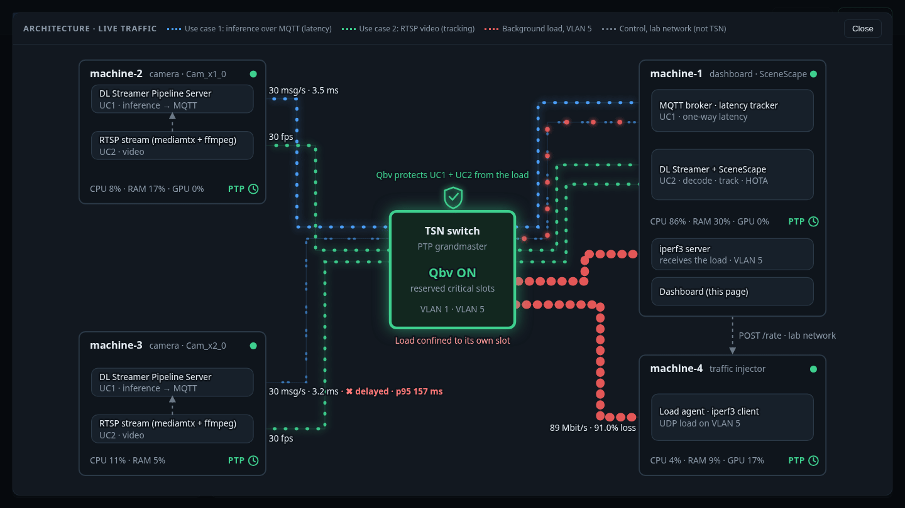

<!--hide_directive
```{eval-rst}
.. meta::
   :description: Set up four machines and a Moxa Time-Sensitive Networking (TSN) switch, then start both use cases with a single command.
   :keywords: Moxa TSN-G5000, Time-Sensitive Networking, TSN, Qbv, PTP, VLAN, DL Streamer, Scenescape, MQTT, RTSP, Basler
```
hide_directive-->

# Get Started

This guide walks you through setting up four machines and a Moxa Time-Sensitive Networking
(TSN) switch. Once they are ready, you can start both use cases with a single command.

## Prerequisites

- Four machines and a Moxa TSN-G5000 switch as listed in [System requirements](./system-requirements.md).
- Machine-1 is the machine you work on. It has `git`, `make`, and Docker, and passwordless SSH
  works from it to machines 2, 3, and 4 (`ssh-copy-id <user>@<machine>`). Your user is in the
  `docker` group on all four machines. For more details, see
  [First-time setup](./first-time-setup.md).

## Clone the Project

```bash
git clone https://github.com/open-edge-platform/federal-and-aerospace-ai-suite.git
cd federal-and-aerospace-ai-suite/deterministic-threat-detection
```

Clone it on machine-1 only: `make up` copies what the other machines need. The one-time setup scripts are
the exception. The [First-time setup](./first-time-setup.md) guide explains how to copy them manually.

## First-Time Setup

The one-time steps per machine and for the switch are described in
[First-time setup](./first-time-setup.md). They cover SSH and Docker, NIC and VLANs,
Precision Time Protocol (PTP), switch configuration, and `lab.env`. Skip this step once the
setup is complete.

## Architecture Diagram





- **machine-2 / machine-3:** replay a test video as an RTSP camera and run the use case 1
  inference pipeline, which publishes its results over MQTT.
- **machine-1:** receives the MQTT results (use case 1), pulls both RTSP streams once, decodes
  and tracks them with Deep Learning Streamer (DL Streamer) and Scenescape (use case 2), and
  serves the dashboard.
- **machine-4:** generates the background load on VLAN 5.
- **Switch:** PTP grandmaster; with the IEEE 802.1Qbv Time-Aware Shaper (Qbv) on, VLAN 5 is
  confined to its own time slot.
- **Lab network (grey):** SSH, load control, and switch commands; never shaped.

The same diagram is live in the dashboard (**Architecture** button).

## Application Deployment

```bash
make up
```

`make up` starts the test-video streams, the dashboard, the load agent, the camera pipelines, and
Scenescape.

- The first run pulls the Docker images (several GB; the DL Streamer image alone is about 5 GB)
  and downloads the detection model, so it takes several minutes.
- Before the first model download, `make up` asks you to accept the model license (Open Model
  Zoo, Apache-2.0). Answering anything other than `yes` aborts the setup. The answer is remembered
  in `src/data/models/.terms-accepted`. For non-interactive runs, set `ACCEPT_MODEL_TERMS=yes`.

When `make up` finishes, it prints:

- Dashboard: `https://<machine-1 lab address>/dashboard/`
- Scenescape: `https://<machine-1 lab address>/` (user `admin`, password in
  `src/scene/secrets/supass`)

The certificate is self-signed, so accept the browser warning.

Try it:

1. **Use case 1** shows the latency per camera (about 2 ms when idle).

   

2. **Use case 2** shows the live tracking quality, Higher Order Tracking Accuracy (HOTA), and
   the frames the tracker sees. The dip to about 0 once per minute occurs when the 62 s test
   video restarts.

   

3. Switch off Qbv and move **Network load** to 1000 Mbit/s. The toggle works only after you set
   `SWITCH_ALLOW_WRITE=1`; see
   [First-time setup](./first-time-setup.md#6-lab-configuration-machine-1). The latency climbs
   from milliseconds to seconds, and the tracker rate and HOTA (use case 2) collapse. The
   Architecture view shows the streams stalling and frames being lost.

   

4. Switch Qbv on. The load is confined to its slot (about 95 Mbit/s gets through), and both
   use cases recover.

   

Qbv takes about 10 s to turn on and up to 30 s to turn off. The toggle shows the actual switch
state.

```bash
make status
make down
```

## Basler Testing

Use two Basler GigE cameras instead of the test videos for use case 2. Prepare them first by
following these guides:
[Configure Basler PTP timestamps](./how-to-guides/basler/configure-basler-ptp-timestamps.md) and
[Integrate Basler cameras with Scenescape](./how-to-guides/basler/integrate-basler-camera-with-scenescape.md).
The second guide also explains how to build the pipeline server image with the Basler SDK
yourself, because the project does not ship it.

```bash
make up SOURCE=basler
make down
```

The test-video streams still start because use case 1 needs them on machines 2 and 3, so do
not pass `STREAMS=0`. Always pass `SOURCE=basler` on the command line. The default is `video`.
HOTA is not shown for Basler cameras because there is no ground truth. The tracker rate is
shown instead.

## Troubleshooting

| Symptom                           | Fix                                                                                                                             |
| --------------------------------- | ------------------------------------------------------------------------------------------------------------------------------- |
| Browser shows `400 Bad Request`   | The host in the URL is not allowed; use the lab address printed by `make up`                                                    |
| Qbv toggle disabled with a banner | Turn on **Schedule Gate** for port 1 in the switch web interface                                                                |
| Qbv toggle disabled, read-only    | Set `SWITCH_ALLOW_WRITE=1` in `src/dashboard/.env` and run `make up` again                                                      |
| Latency stays high with Qbv on    | Check the VLAN priority maps (`ip -d link show tsn0.1` lists `egress_qos`) and PTP (`sudo ptp-profile status`)                  |
| Basler `Device::open()` fails     | Another process holds the camera. Stop the pipeline container with `docker stop -t 30`, then retry                              |
| A start failed halfway            | Run `make down`, fix the cause, and run `make up` again. `make -C src/scene clean` also deletes the Scenescape database volumes |

## Key References

- [Moxa TSN-G5000 series](https://www.moxa.com/en/products/industrial-network-infrastructure/ethernet-switches/layer-2-managed-switches/tsn-g5008-series)
- [Scenescape](https://github.com/open-edge-platform/scenescape)
- [DL Streamer](https://github.com/open-edge-platform/dlstreamer)
- [TrackEval (HOTA)](https://github.com/JonathonLuiten/TrackEval)
- [First-time setup](./first-time-setup.md)
- [How-to guides](./how-to-guides.md)

<!--hide_directive
:::{toctree}
:hidden:

system-requirements
first-time-setup
how-to-guides

:::
hide_directive-->
