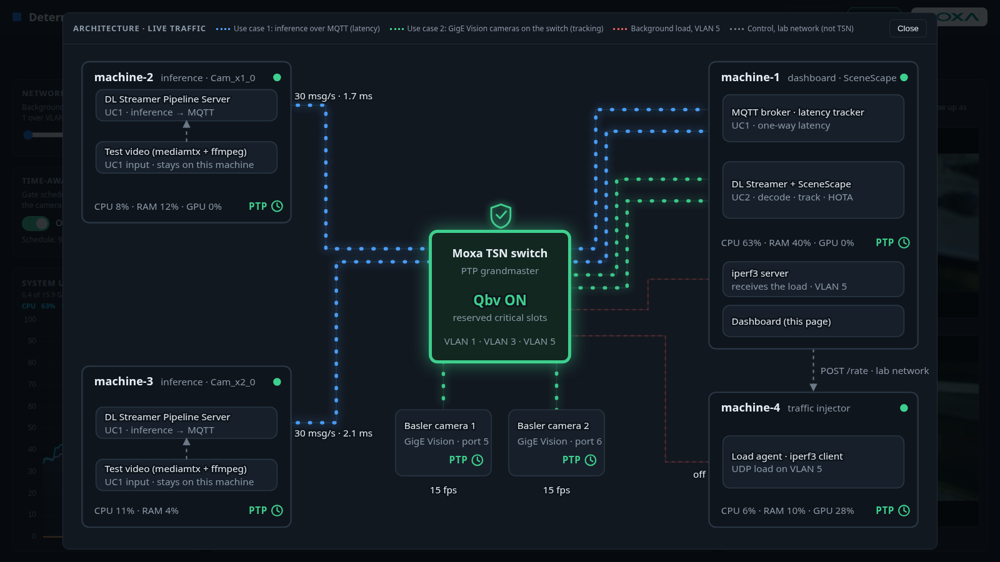
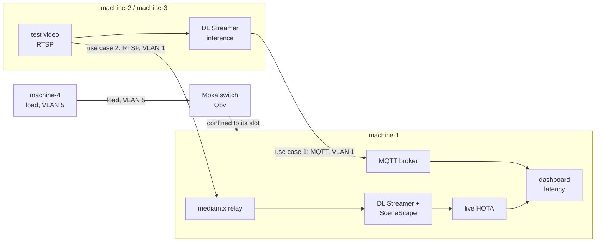

# Get Started

Set up four machines and a Moxa TSN switch, then start both use cases with one command.

## Prerequisites

- Four machines and a Moxa TSN-G5000 switch as listed in [System requirements](./system-requirements.md).
- Machine-1 is the machine you work on. Passwordless ssh works from it to machines 2, 3 and 4
  (`ssh-copy-id <user>@<machine>`), and your user is in the `docker` group on all four.

## First time setup guide

One-time steps per machine and for the switch (NIC and VLANs, PTP, switch, `lab.env`):
**[First-time setup](./first-time-setup.md)**. Skip it once done.

## Clone the project

```bash
git clone <repository URL> federal-and-aerospace-ai-suite
cd federal-and-aerospace-ai-suite/deterministic-threat-detection
```

Clone it on machine-1 only. `make up` copies what the other machines need.

## Architecture diagram





- **machine-2 / machine-3:** replay a test video as an RTSP camera, and run the use case 1
  inference pipeline, which publishes results over MQTT.
- **machine-1:** receives MQTT (use case 1), pulls both RTSP streams once, decodes and tracks them
  with DL Streamer and SceneScape (use case 2), and serves the dashboard.
- **machine-4:** generates the background load on VLAN 5.
- **Switch:** PTP grandmaster; with Qbv on, VLAN 5 is confined to its own time slot.
- **Lab network (grey):** ssh, load control and switch commands. Never shaped.

The same diagram is live in the dashboard (**Architecture** button).

## Application Deployment

```bash
make up
```

`make up` starts the test-video streams, the dashboard, the load agent, the camera pipelines and
SceneScape. The first run pulls images and takes several minutes. When it finishes it prints:

- Dashboard: `https://<machine-1 lab address>/dashboard/`
- SceneScape: `https://<machine-1 lab address>/` (user `admin`, password in
  `src/scene/secrets/supass`)

The certificate is self-signed; accept the browser warning.

Try it:

1. **Use case 1** shows latency per camera (about 2 ms idle).
2. Switch off Qbv and move **Network load** to 1000 Mbit/s: latency climbs from milliseconds to
   seconds and the tracker rate (use case 2) and HOTA collapse.
3. Switch Qbv on: the load is confined to its slot and both recover.

Qbv takes about 10 s to turn on and up to 30 s to turn off; the toggle shows the real switch state.

```bash
make status
make down
```

## Basler testing

Use two Basler GigE cameras instead of the test videos for use case 2. Prepare them first:
[Configure Basler PTP timestamps](./how-to-guides/basler/configure-basler-ptp-timestamps.md) and
[Integrate Basler cameras with SceneScape](./how-to-guides/basler/integrate-basler-camera-with-scenescape.md).

```bash
make up SOURCE=basler STREAMS=0
make down
```

`STREAMS=0` skips the test-video publishers. Always pass `SOURCE=basler` on the command line;
the default is `video`. HOTA is not shown for Basler (no ground truth); the tracker rate is.

## Troubleshooting

| Symptom | Fix |
|---------|-----|
| Browser shows `400 Bad Request` | The host in the URL is not allowed; use the lab address printed by `make up` |
| Qbv toggle disabled with a banner | Turn on **Schedule Gate** for port 1 in the switch web page |
| Qbv toggle disabled, read-only | Set `SWITCH_ALLOW_WRITE=1` in `src/dashboard/.env`, run `make up` again |
| Latency stays high with Qbv on | Check the VLAN priority maps (`ip -d link show tsn0.1` lists `egress_qos`) and PTP (`sudo ptp-profile status`) |
| Basler `Device::open()` fails | Another process holds the camera: `docker stop -t 30` the pipeline container, then retry |

## Key References

- [MOXA TSN-G5000 series](https://www.moxa.com/en/products/industrial-network-infrastructure/ethernet-switches/layer-2-managed-switches/tsn-g5008-series)
- [SceneScape](https://github.com/open-edge-platform/scenescape)
- [DL Streamer](https://github.com/open-edge-platform/dlstreamer)
- [TrackEval (HOTA)](https://github.com/JonathonLuiten/TrackEval)
- [First-time setup](./first-time-setup.md)
- [How-to guides](./how-to-guides.md)

<!--hide_directive
:::{toctree}
:hidden:

system-requirements
first-time-setup
how-to-guides

:::
hide_directive-->
