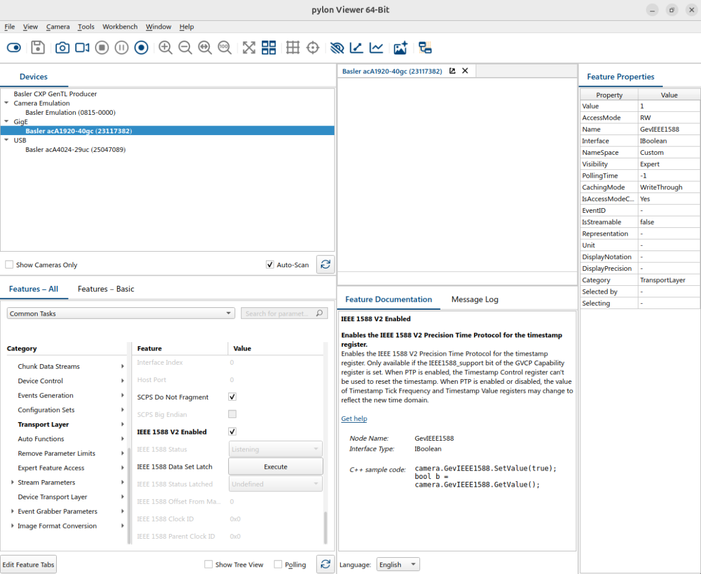

# Configure the Basler Camera to Use PTP Timestamps

The camera embeds a hardware PTP timestamp in every frame, so the capture time is known to
sub-microsecond accuracy. Done once per camera, with the pylon Viewer on any computer.

## Prerequisites

- Switch and machine-1 on IEEE 1588v2: [Configure PTP 1588v2](../moxa/configure-ptp-1588v2.md).
- Camera cabled to a switch port in VLAN 3 (ports 5 and 6 in this demo).
- Basler pylon Viewer installed.

## Steps

1. **Static IP.** In pylon IP Configurator (`Tools > pylon IP Configurator`) set an address in the
   VLAN 3 subnet: `192.168.3.17` and `192.168.3.18` in this demo.
2. **Enable PTP.** In the **PTP** feature group enable PTP so the timestamps come from the PTP clock.

   

3. **Match the switch profile:**

   | Parameter | Value |
   |-----------|-------|
   | Profile | 1588v2 Default Profile |
   | Clock type | Boundary clock |
   | Delay mechanism | End-to-End |
   | Transport mode | UDP IPv4 |
   | Domain number | 0 |
   | Priority 1 / 2 | 64 / 128 |

## Verify

The **IEEE 1588 Parent Clock ID** in the PTP group equals the switch's clock ID (its MAC address).
