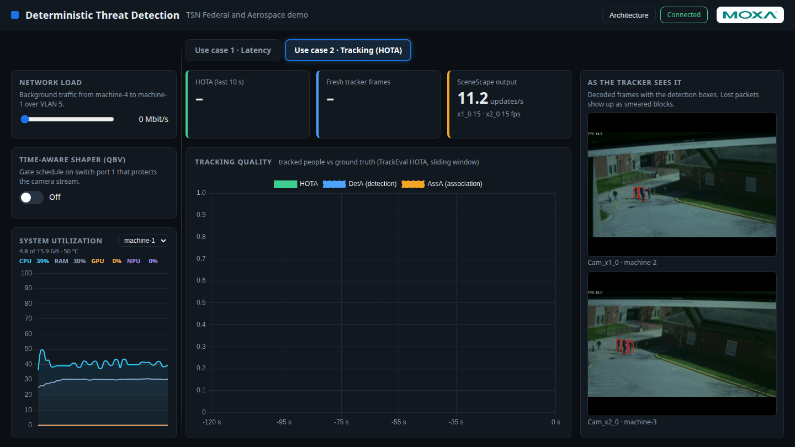
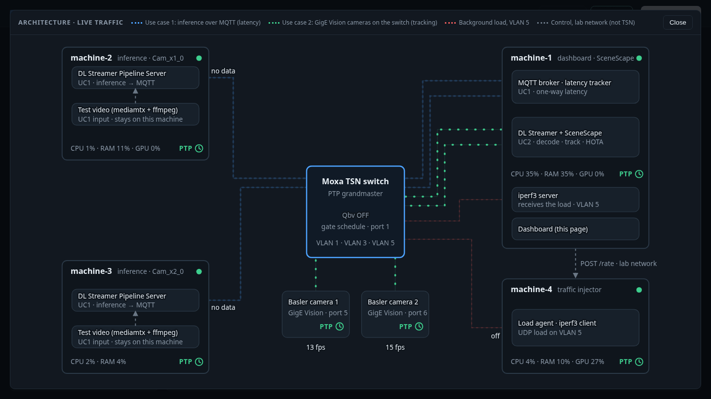
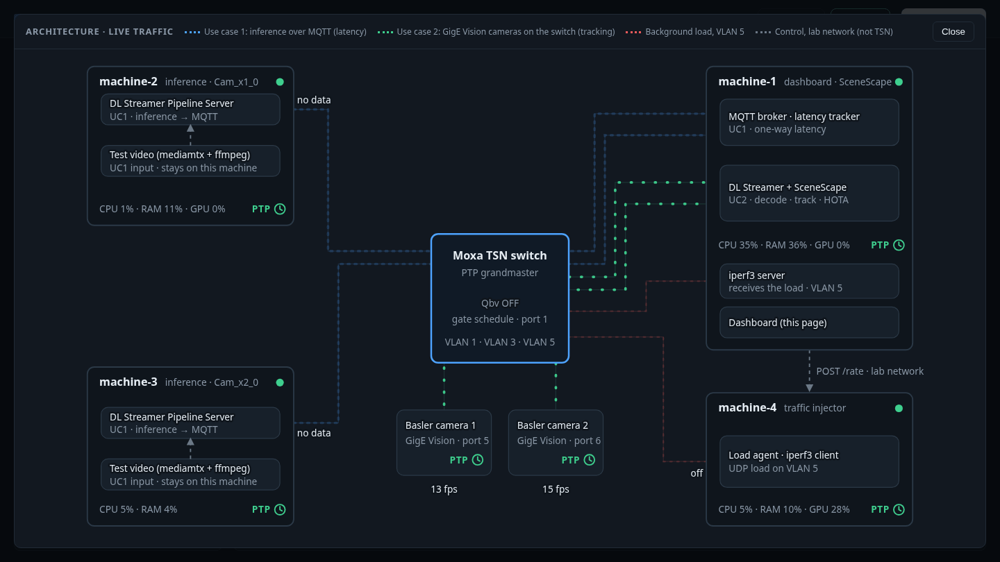
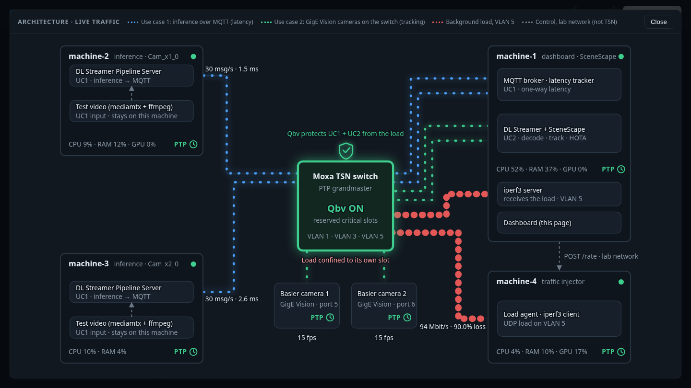

# Integrate Basler Cameras with SceneScape

Use two Basler GigE cameras as the sources for use case 2. `make up SOURCE=basler` does the build
and wiring; below are the one-time preparation and what the build does.

## Prepare (once)

1. Configure the cameras: [Configure Basler PTP timestamps](./configure-basler-ptp-timestamps.md).
2. Create VLAN 3 on machine-1 ([First-time setup](../../first-time-setup.md)); the cameras sit in
   VLAN 3 on switch ports 5 and 6.
3. Give the camera ports priority 0. Untagged camera frames take the port's priority; priority 3
   would put the camera video in the same queue as other VLAN 3 traffic and starve MQTT
   under the Qbv schedule. Run on machine-2 after `make -C src/dashboard deploy-switch`:

   ```bash
   python3 -I ~/moxa/port_priority.py set --host <switch address> --ports 5,6 --value 0
   python3 -I ~/moxa/port_priority.py get --host <switch address> --ports 5,6
   ```

4. In `src/scene/.env` set the camera serial numbers (created from `.env.example` by the first
   `make up`) and, if needed, the macvlan address (it must be free):

   ```text
   BASLER_CAMERA1_SERIAL=<serial of camera 1>
   BASLER_CAMERA2_SERIAL=<serial of camera 2>
   BASLER_CONTAINER_IP=192.168.3.61
   BASLER_FPS=15
   ```

## Run

```bash
make up SOURCE=basler STREAMS=0
make down
```

Always pass `SOURCE=basler` (a plain `docker compose up` has no camera plugin and the pipelines
fail with `no element "gencamsrc"`).



The Architecture view shows the two cameras on switch ports 5 and 6. With Qbv off, the load
starves them; with Qbv on, both keep their frame rate.







The dashboard shows the tracker rate and the decoded frames. HOTA is not meaningful here: there
is no ground truth and no frame number.

## What the build does

- Builds `tsn-dlstreamer-pipeline-server-basler` from the DL Streamer Pipeline Server image plus
  the pylon SDK (`src/scene/basler/BaslerDockerfile`).
- Attaches the container to a macvlan network on `tsn0.3` so it can reach the cameras.
- Runs `gencamsrc ... ! gvapython` with `src/scene/dlstreamer-pipeline-server/sscape_adapter.py`,
  which publishes the camera's PTP hardware timestamp as the frame time.

## Troubleshooting

- `Device::open()` fails: the camera is still held. `docker stop -t 30` the pipeline container,
  wait, then `make up SOURCE=basler STREAMS=0` again.
- 1970 timestamps: the camera's PTP is not locked yet (timestamp 0 is ignored by the adapter).
- No cameras found: `ping 192.168.3.17` from machine-1 and check the camera IPs.
