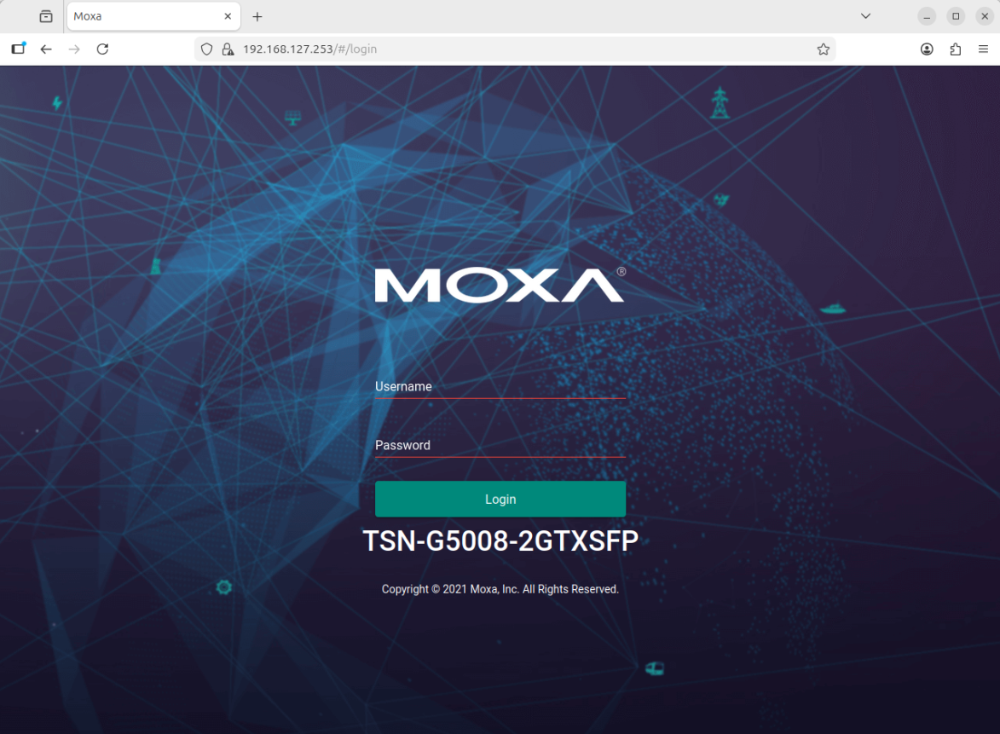

# Configure the Moxa TSN Switch

The Moxa TSN-G5000 is the network fabric of the demo: PTP grandmaster, VLAN separation and the
IEEE 802.1Qbv Time-Aware Shaper.

> [!NOTE]
> These guides are a reference for changing the switch. For a normal install follow
> [First-time setup](../../first-time-setup.md).

## Access the web interface

After a reset the switch has the address `192.168.127.253`, user `admin`, password `moxa`.
Put your computer in the same subnet to open it.

## What this demo needs on the switch

| Setting | Value | Guide |
|---------|-------|-------|
| VLANs 1, 3, 5 | Tagged on ports 1 to 4 | [VLAN](./configure-vlan-on-moxa-switch.md) |
| PTP profile | 1588v2 default, or 802.1AS | [1588v2](./configure-ptp-1588v2.md), [gPTP](./configure-ptp-gptp.md) |
| Time-Aware Shaper | Schedule Gate on for port 1 | [Qbv](./enable-tsn-traffic-shaping.md) |
| Management | Telnet enabled (the dashboard scripts use it); keep VLAN 1 and a port the shaper never touches | |

## Scripts

`src/switch/` drives the switch over Telnet. The dashboard runs them on machine-2:

| Script | Purpose |
|--------|---------|
| `tas_config.py get\|set\|clear --port N` | Qbv gate schedule |
| `port_priority.py get\|set --ports 5,6 --value 0` | Default priority of untagged ports |
| `ptp_profile.py get\|1588v2\|802.1as` | PTP profile |
| `capture_web.py` | Screenshots of the web pages |

Port 2 (the management path of machine-2) is refused by the scripts.

## Further reading

[Moxa TSN-G5000 Series User Manual](https://www.moxa.com/getmedia/a0db0ef9-2741-4bad-91c6-1ec1827aca64/moxa-tsn-g5000-series-web-console-manual-v2.3.pdf)
