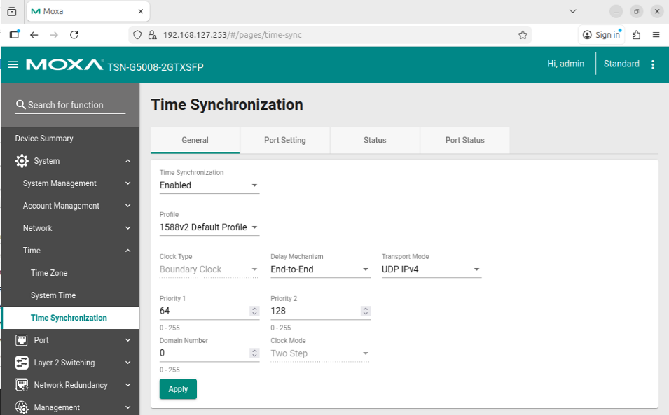

# Configure PTP, IEEE 1588v2

This guide explains how to configure the IEEE 1588v2 profile (the default profile, over UDP IPv4) on the switch and on the machines. The demo uses this profile instead of 802.1AS since the Basler GigE cameras support only 1588v2. In this setup, the switch acts as the grandmaster, and the machines and cameras follow it as slaves. Make sure that the switch and all machines use the same profile. If you prefer the alternative, see [Configure PTP, IEEE 802.1AS (gPTP)](./configure-ptp-gptp.md).

## Switch

Set the profile in the web interface (System > Time > Time Synchronization), or run
`python3 ptp_profile.py 1588v2` from `src/switch/` on a machine that reaches the switch
(`python3 ptp_profile.py --help` lists the options).



| Setting | Value |
| --------- | ------- |
| Profile | IEEE 1588v2 Default Profile |
| Transport | UDP IPv4 |
| Role | Grandmaster (or boundary clock towards the camera port) |

## Machines

`ptp-install.sh` installs the services once with this profile as the default
([First-time setup](../../first-time-setup.md#3-ptp-every-machine)). To switch back to it later, use the following commands:

```bash
sudo ptp-profile ieee1588
sudo ptp-profile status
```

Equivalent manual commands (`-4` needs an IPv4 address on `tsn0`; `setup_tsn_nic.sh` gives it a base
address such as `192.168.11.11`):

```bash
sudo ptp4l -i tsn0 -4 -E -s -m --priority1=255 --domain=0
sudo phc2sys -s tsn0 -c CLOCK_REALTIME --step_threshold=1 -w -m -O 0
```

`-4` selects UDP IPv4 and `-E` the end-to-end delay mechanism, matching the camera. `phc2sys` steps `CLOCK_REALTIME`,
so NTP clients must be off.

## Verify

Once locked, the `phc2sys` offset is far below 1 µs (typically under 100 ns):

```text
phc2sys[1234.567]: CLOCK_REALTIME phc offset 42 s2 freq -1234 delay 512
```
