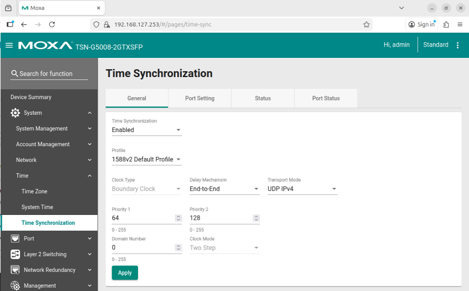

# Configure PTP, IEEE 1588v2

IEEE 1588v2 (default profile, UDP IPv4) is used instead of 802.1AS because the Basler GigE cameras
only support it. The switch is the grandmaster; machines and cameras are slaves. All machines and
the switch must use the same profile: see [gPTP](./configure-ptp-gptp.md) for the other one.

## Switch

Set the profile in the web page (System > Time > Time Synchronization), or run
`python3 ptp_profile.py 1588v2` from `src/switch/`.



| Setting | Value |
|---------|-------|
| Profile | IEEE 1588v2 Default Profile |
| Transport | UDP IPv4 |
| Role | Grandmaster (or boundary clock towards the camera port) |

## Machines

`ptp-install.sh` installs the services once with this profile as default
([First-time setup](../../first-time-setup.md#2-ptp-every-machine)). To switch back later:

```bash
sudo ptp-profile ieee1588
sudo ptp-profile status
```

Equivalent manual commands (the interface needs an IP address; use `tsn0` with its VLAN or base address):

```bash
sudo ptp4l -i tsn0 -4 -E -s -m --priority1=255 --domain=0
sudo phc2sys -s tsn0 -c CLOCK_REALTIME --step_threshold=1 -w -m -O 0
```

`-4` is UDP IPv4, `-E` end-to-end delay, matching the camera. `phc2sys` steps `CLOCK_REALTIME`,
so NTP clients must be off.

## Verify

Once locked the `phc2sys` offset is far below 1 µs (typically under 100 ns):

```text
phc2sys[1234.567]: CLOCK_REALTIME phc offset 42 s2 freq -1234 delay 512
```
