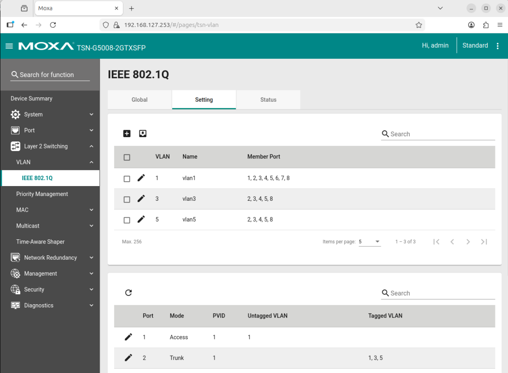
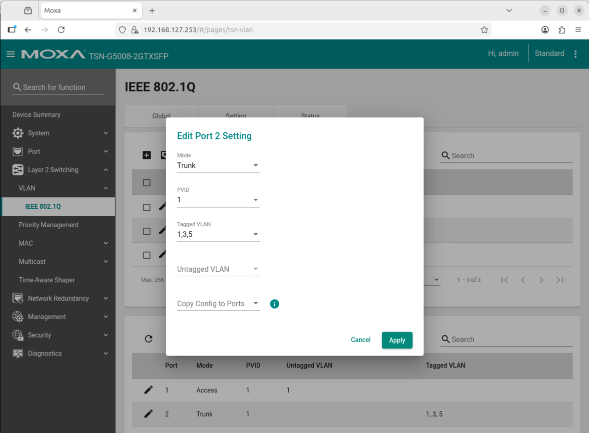

# Configure VLANs on the Moxa Switch

This guide explains how to create VLANs on the Moxa switch and assign them to the ports that your machines and cameras use.

## Prerequisites

The switch is reachable as described in [Configure the Moxa TSN switch](./configure-moxa-switch.md).

## Configure the VLANs

Identify the switch port for each connected machine. You will then configure each port to
handle tagged VLAN traffic for the specific VLAN IDs the connected machine requires.

> [!NOTE]
> In this demo, ports 1 to 4 (machines 1 to 4) carry VLANs 1, 3 and 5 tagged. Ports 5 and 6
> (Basler cameras) are untagged members of VLAN 3 with PVID 3.

1. Open the Moxa switch web interface by entering the switch's IP address (`192.168.127.253`
   after a reset) in a web browser.
2. Log in (after a reset: user `admin`, password `moxa`).
3. Navigate to **VLAN > IEEE 802.1Q** in the menu.
4. Create VLANs with IDs 1, 3 and 5 if they do not already exist.
   
5. Assign the appropriate ports to the VLANs as tagged ports by clicking the edit icon (🖉) of the
   specific port.
   
6. Apply the configuration and reboot the switch if necessary.
7. Verify the VLAN configuration by checking the port settings and ensuring that the correct
   VLANs are assigned.

## Further reading

[Moxa TSN-G5000 Series User Manual](https://www.moxa.com/getmedia/a0db0ef9-2741-4bad-91c6-1ec1827aca64/moxa-tsn-g5000-series-web-console-manual-v2.3.pdf)