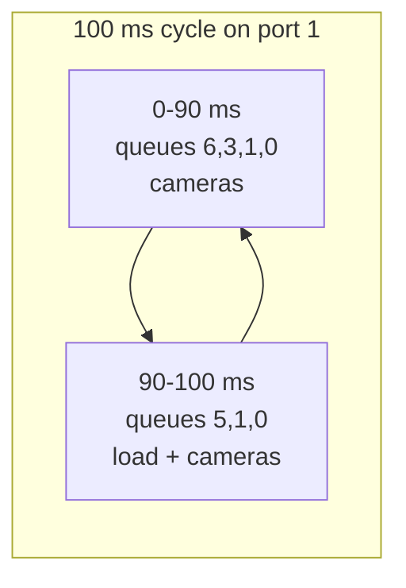
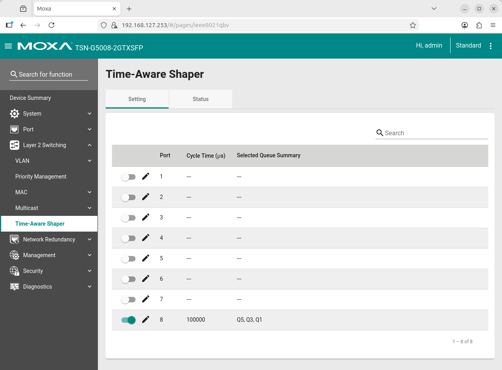
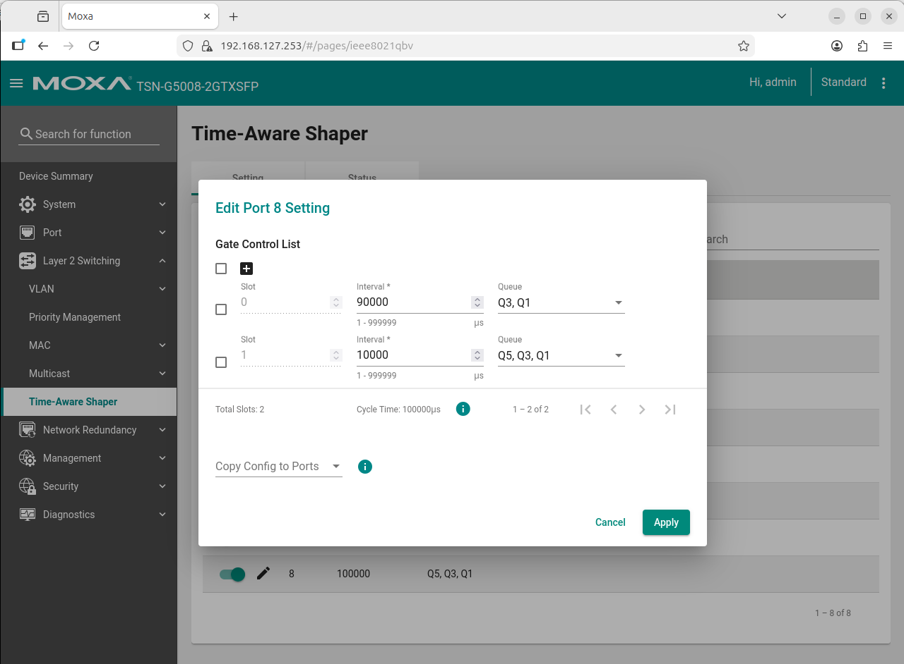

# Enable TSN Traffic Shaping (IEEE 802.1Qbv)

The Time-Aware Shaper opens and closes the egress queues of a port on a repeating schedule, so
critical traffic gets protected time slots and background load cannot delay it.

## What the demo uses

Port 1 (towards machine-1, where all cameras' data and the load arrive) runs a 100 ms cycle:

| Slot | Length | Open queues | Traffic |
|------|--------|-------------|---------|
| 0 | 90 ms | 6, 3, 1, 0 | Cameras (VLAN 1 = queue 1, VLAN 3 = queue 3) |
| 1 | 10 ms | 5, 1, 0 | Background load (VLAN 5 = queue 5) and cameras |

Frame priority (PCP) selects the queue, so the load (PCP 5) can only leave in the 10 ms slot:
about 10% of the link. Without the shaper the load (PCP 5) outranks the cameras (PCP 1) and starves them.



## Steps

1. **Turn the shaper on for the port.** Web page: Layer 2 Switching > Time-aware Shaper > edit the
   port > enable **Schedule Gate**. The command line cannot do this, so without it the schedule is
   stored but never runs.

   

2. **Set the schedule.** Either use the web page:

   

   or the script (run from machine-2 after `make -C src/dashboard deploy-switch`):

   ```bash
   python3 -I ~/moxa/tas_config.py set --port 1 --slot 90000:6,3,1,0 --slot 10000:5,1,0
   python3 -I ~/moxa/tas_config.py get --port 1
   python3 -I ~/moxa/tas_config.py clear --port 1
   ```

   The dashboard toggle runs `set` / `clear` for you. Enabling takes about 10 s, disabling up to 30 s.

3. **Verify.** `get` must report `operative: active`. If it says `not active`, step 1 was missed.

> [!IMPORTANT]
> Slot lengths and queues depend on your streams, packet sizes and latency needs. The values
> above are the demo's. Keep the queues used by PTP and management open at all times, and never
> shape the port that carries your own management session (the scripts refuse port 2).

Reference: [Moxa TSN-G5000 Series User Manual](https://www.moxa.com/getmedia/a0db0ef9-2741-4bad-91c6-1ec1827aca64/moxa-tsn-g5000-series-web-console-manual-v2.3.pdf)
