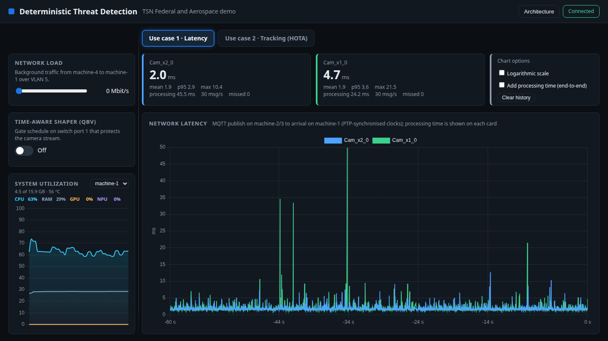
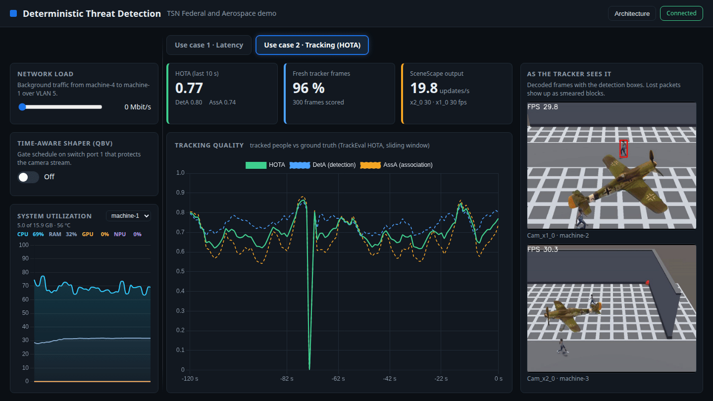

# Deterministic Threat Detection with Time-Sensitive Networking (TSN) - Preview

The Deterministic Threat Detection application shows how a Time-Sensitive Networking (TSN) switch keeps AI video workloads deterministic while the
network is flooded with background traffic.
The application uses a IEEE 802.1Qbv Time-Aware Shaper (TAS) which confines the background load to its own time slot, so the camera traffic keeps its low latency and the tracking quality remains stable.
The application provides one web dashboard that you use to run two use cases, presented below.

| Use case | What it shows | Metric |
| ---------- | --------------- | -------- |
| **1 - Latency** | Two cameras run AI inference and publish the results over MQTT | One-way network latency per message |
| **2 - Tracking** | Scenescape fuses two camera views into tracked people | Live Higher Order Tracking Accuracy (HOTA) score (test videos) or tracker rate (Basler cameras) |

A slider injects User Datagram Protocol (UDP) load of up to 1 Gbit/s from a fourth machine. A toggle enables the
IEEE 802.1Qbv Time-Aware Shaper on the switch. With the shaper off, the load starves both use cases;
with it on, they are unaffected.

## Learn more

- [System requirements](./system-requirements.md)
- [First-time setup](./first-time-setup.md)
- [Get started](./get-started.md)
- [How-to guides](./how-to-guides.md)
- [Release notes](./release-notes.md)

<!--hide_directive
:::{toctree}
:hidden:

system-requirements
first-time-setup
get-started
how-to-guides
Release Notes <./release-notes.md>

:::
hide_directive-->
