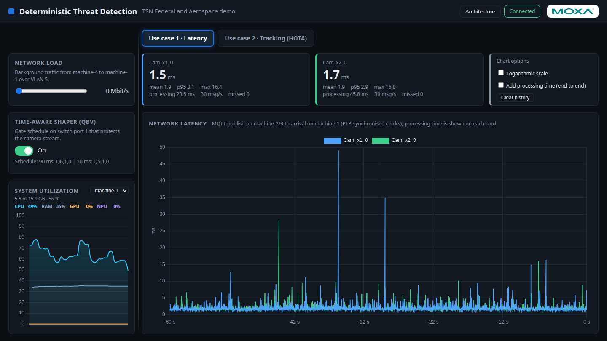
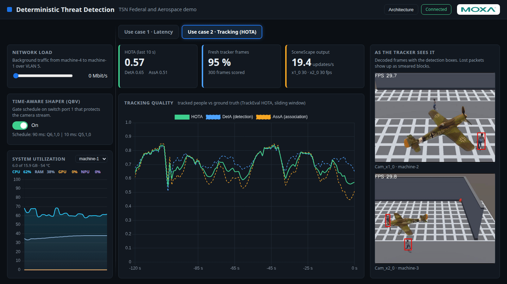

# Deterministic Threat Detection with Time-Sensitive Networking (TSN) - Preview

Shows how a Time-Sensitive Networking switch keeps AI video workloads deterministic while the
network is flooded with background traffic. One web dashboard, two use cases:

| Use case | What it shows | Metric |
|----------|---------------|--------|
| **1 - Latency** | Two cameras run AI inference and publish the results over MQTT | One-way network latency per message |
| **2 - Tracking** | SceneScape fuses two camera views into tracked people | Live HOTA score (test videos) or tracker rate (Basler cameras) |

A slider injects load (UDP, up to 1 Gbit/s) from a fourth machine. A toggle enables the
IEEE 802.1Qbv Time-Aware Shaper on the switch. With the shaper off the load starves both use cases;
with it on they are not affected.

## Learn more

- [System requirements](./system-requirements.md)
- [First-time setup](./first-time-setup.md)
- [Get started](./get-started.md)
- [How-to guides](./how-to-guides.md)
- [Release notes](./release-notes.md)

<!--hide_directive
:::{toctree}
:hidden:

system-requirements
first-time-setup
get-started
how-to-guides
Release Notes <./release-notes.md>

:::
hide_directive-->
