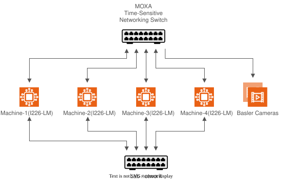

# System Requirements

## Machines

Four Linux machines, all cabled to the same Moxa TSN switch and to a lab network.

| Machine | Role | Switch port |
|---------|------|-------------|
| machine-1 | Dashboard, SceneScape, DL Streamer, MQTT broker. Also where you run `make` | 1 |
| machine-2 | Camera 1: test-video stream and inference | 2 |
| machine-3 | Camera 2: test-video stream and inference | 3 |
| machine-4 | Load injector | 4 |

Each machine needs an Intel I225-LM or I226-LM TSN network card (PCI `8086:15f2` / `8086:125b`).
Machine-1 needs about 8 CPU cores for the full stack.

## Network topology

Ports 1 to 4 carry VLAN 1 (camera data, priority 1), VLAN 3 (Basler) and VLAN 5 (load, priority 5).
The dotted lab network is never shaped.

## Software

- Ubuntu 24.04
- Docker Engine with Docker Compose V2 (all machines)
- `linuxptp` and NetworkManager (installed or used by the setup scripts)
- Passwordless `ssh` from machine-1 to machines 2, 3 and 4 (key based)
- Internet or proxy access on machine-1 to pull the Docker images and to download the detection model (`src/data/download_models.sh`, runs automatically in `make up`; Open Model Zoo, Apache-2.0; you are asked to accept the license on the first download)

## Network

- **Lab network:** ssh, dashboard in the browser, control traffic. Not part of the TSN path.
- **TSN switch:** VLAN 1 (`192.168.127.x`) camera data, VLAN 5 (`192.168.5.x`) background load,
  VLAN 3 (`192.168.3.x`) Basler cameras.

## Hardware

| Component | Details |
|-----------|---------|
| Moxa TSN-G5000 switch | IEEE 802.1Qbv and 1588v2/802.1AS. Tested with TSN-G5008-2GTXSFP, firmware 2.1 |
| Basler ace GigE cameras (optional) | PTP hardware timestamps, for the Basler test only. Tested with acA1920-40GC |
