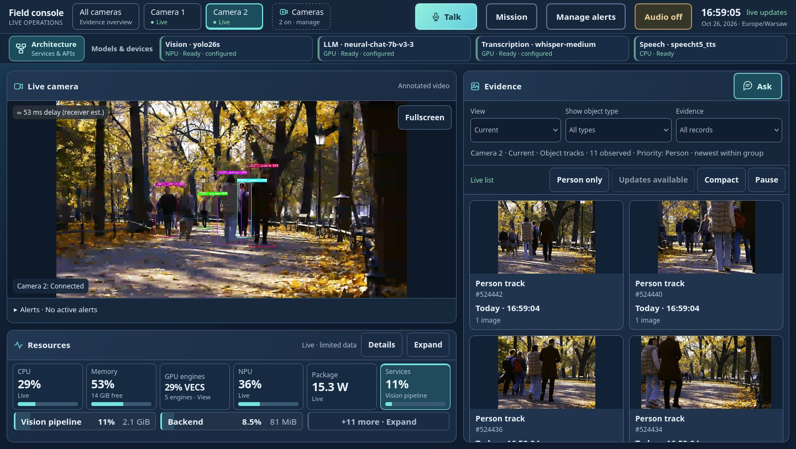

# Handheld Multi-Modal Application

The Handheld Multi-Modal application is a multi-modal AI operator console for handheld
deployment scenarios, optimized for Intel® edge hardware. It combines live camera analytics,
evidence search, mission documents, rule-based alerts, and voice interaction in a
single browser UI that runs entirely on the device.

The application is built from published container images from Open Edge Platform,
open source media and messaging components, and an
application Backend with a browser UI. Video analytics run on the NPU, the language and
speech-to-text models run on the GPU, and text-to-speech runs on the CPU. Models and
dependencies are downloaded from the Internet on the first start. After that, all
inference runs locally and data does not leave the device.

The application is deployed on top of the Edge Node Infrastructure software - an edge
computing platform, which enables hardware acceleration capabilities. See
[Infrastructure Setup](../infrastructure-setup.md) for build and provisioning steps.

## Deployment and Usage

Follow these steps to deploy and use the application:

1. [Install Handheld Multi-Modal Application](./install-multimodal.md) — Download and deploy the application stack.
2. [Access Application User Interface](./access-application.md) — Open the operator console locally or through an SSH tunnel.
3. [Operator Guide](./operator-guide.md) — Use cameras, evidence, the assistant, mission documents, alerts, and voice.
4. [Application Operations](./application-operations.md) — Lifecycle commands, offline copy to other devices, and model changes.

## Features

- **Live cameras** — YOLO26s INT8 object detection (NPU) and tracking, annotated WebRTC
  video, and cropped evidence images per tracked object. Cameras are added, renamed, and
  removed from the console.
- **History** — browse recorded tracks and ask questions such as "how many people on
  camera 2 in the last ten minutes?".
- **Mission** — upload PDF or DOCX orders; the Mission Brief and answers are produced by
  `Intel/neural-chat-7b-v3-3` (GPU) through the Chat Q&A microservice.
- **Alerts** — operator rules ("appears", "stays too long", optional zones) dispatched by
  the Alert Agent and spoken by SpeechT5.
- **Voice** — push-to-talk questions transcribed by Whisper-medium (GPU) and spoken answers.
- **Resources** — CPU, memory, GPU, NPU, power, and per-service telemetry.

## Architecture

The Backend is never in the video path: MediaMTX relays camera RTSP to the DL Streamer
Pipeline Server, which publishes annotated video back over WebRTC (WHIP) and detection
events over MQTT. The browser plays video directly from MediaMTX (WHEP) and talks to the
Backend over HTTPS, Server-Sent Events, and WebSocket. The running application also serves
an interactive architecture page at `/architecture.html`.

## Components

| Service | Image | Role |
|---------|-------|------|
| DL Streamer Pipeline Server | `intel/dlstreamer-pipeline-server` | Detection, tracking, annotated WebRTC, MQTT events, evidence crops |
| Chat Q&A Core | `intel/chatqna` (OpenVINO runtime) | Mission documents and assistant answers |
| Audio Analyzer | `intel/audio-analyzer` | Speech-to-text (Whisper-medium, GPU) |
| Text To Speech | `intel/text-to-speech` | Spoken alerts and answers (SpeechT5) |
| Alert Agent | `intel/alert-agent-service` | Rule-mode alert dispatch, no LLM in the alert path |
| Metrics Manager | `intel/metrics-manager` | Hardware telemetry |
| Model Download | `intel/model-download` | Prepares the YOLO26s OpenVINO™ IR on the first start |
| MediaMTX | `bluenviron/mediamtx:1.21.3` | RTSP input, WHIP/WHEP relay |
| Coturn | `coturn/coturn:4.18.0-alpine` | Loopback-only TURN relay for tunnelled browsers |
| Mosquitto | `eclipse-mosquitto:2.0.22` | MQTT between the pipeline server and the Backend |
| NGINX | `nginx:1.30.6-alpine` | TLS reverse proxy on `127.0.0.1:8443` |
| FFmpeg | `bluenviron/mediamtx:1.21.3-ffmpeg` | Demo camera publishers only |
| Backend and UI | `handheld/backend:dev` (built locally) | Application logic; calls stock microservice APIs only |

Open Edge Platform services use unmodified published container images. Exact image tags are pinned in
[`compose/handheld-multi-modal.yaml`](https://github.com/open-edge-platform/federal-and-aerospace-ai-suite/blob/release-2026.3.0/handheld-multi-modal/compose/handheld-multi-modal.yaml).

Model sources and licenses are listed in
[third-party-components.spdx](https://github.com/open-edge-platform/federal-and-aerospace-ai-suite/blob/release-2026.3.0/handheld-multi-modal/third-party-components.spdx).

<!--hide_directive
:::{toctree}
:hidden:

Install Handheld Multi-Modal Application <./install-multimodal.md>
Access Application User Interface <./access-application.md>
Operator Guide <./operator-guide.md>
Application Operations <./application-operations.md>

:::
hide_directive-->
