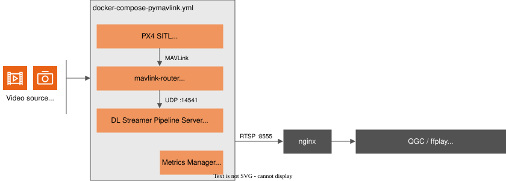
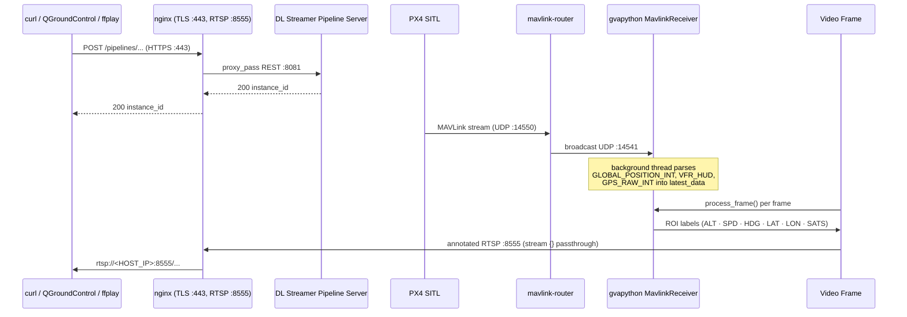

<!--
SPDX-FileCopyrightText: (C) 2026 Intel Corporation
SPDX-License-Identifier: Apache-2.0
-->

# Get Started (Standalone Mode / pymavlink)

This guide provides a step-by-step walkthrough for testing the UAV Vision Analytics application in standalone mode (pymavlink) and running the demo with a simulated UAV camera feed/RealSense cameras.

## How It Works

A self-contained stack. PX4 SITL, MAVLink router, MQTT broker, and Metrics Manager are all started together (`docker-compose-pymavlink.yml`). Telemetry flows from PX4 SITL through `mavlink-router` to the DL Streamer container, where `pymavlink` reads it directly over UDP.



**Telemetry flow:**



**Services:**

| Service | Image | Ports | Role |
| --- | --- | --- | --- |
| `dlstreamer-pipeline-server` | `intel/dlstreamer-pipeline-server` + pymavlink | `8081`, `8555` | AI inference, RTSP output |
| `px4` | `px4io/px4-sitl` | `14550` | Flight controller simulator |
| `mavlink-router` | custom build | `14551` (UDP, published to `HOST_IP`) | MAVLink UDP routing (:14550 → :14541); remote QGroundControl connects to :14551 |
| `metrics-manager` | `intel/metrics-manager` | `9090` | CPU/GPU/NPU/power metrics |
| `nginx` | `nginx:1.27-alpine` | `80` (redirects to 443), `443` (HTTPS, self-signed cert), `8555` (RTSP passthrough) — published to `HOST_IP` | Reverse proxy / TLS termination — publishes the web, RTSP and MQTT ports to the host |

> `dlstreamer-pipeline-server` and `metrics-manager` no longer publish ports directly —
> both are reachable only through `nginx` on the internal `app_network`.

---

## Steps to Test the Application

### System Requirements

See [System Requirements](./system-requirements.md) for the full list of software and hardware prerequisites.

### 1. Configure environment

There are two options available to get the application source:

#### Option A — Download the ZIP (recommended)

Download the compressed file and get into the directory:

```bash
curl -OjL https://github.com/open-edge-platform/edge-ai-suites/releases/download/fedaero-latest/uav-mission-apps.zip
```

Decompress the downloaded file:

```bash
unzip uav-mission-apps.zip
cd uav-vision-analytics
```

#### Option B — Clone the whole repository

Clone the repo and get into the directory:

```bash
git clone https://github.com/open-edge-platform/edge-ai-suites.git --branch main
cd edge-ai-suites/federal-and-aerospace-ai-suite/uav-vision-analytics
```

Then, for either option, initialize the environment:

```bash
make init
```

`make init` creates `.env` from the template and **auto-detects your Intel GPU device paths** (`GPU_DEVICE`, `GPU_RENDER_DEVICE`), **Intel NPU** (`NPU_DEVICE`), and **Intel RealSense / USB camera** (`CAMERA_DEVICE_1`). It skips if `.env` already exists.

Then set your host IP address in `.env`:

```bash
nano .env   # set HOST_IP=<your-machine-IP>
```

### 2. Prepare the model

Download and export the YOLO11s model to OpenVINO FP16 IR:

```bash
make model
```

> See the [AI Model guide](../how-to-guides/model.md) for model details.

### 3. Standalone mode (pymavlink)

```bash
make pymav-up
```

### 4. Start inference pipelines

Two options are available depending on your use case:

#### Option A — Managed RTSP output (recommended)

Runs `pipeline_manager.py` inside the DL Streamer Pipeline Server container. It monitors the drone's ARMED/DISARMED state and automatically starts and stops inference pipelines. Annotated frames are served as RTSP on port `8555`.

`make start-rtsp` starts the cameras listed in [`configs/cameras-pymavlink.yaml`](../../../configs/cameras-pymavlink.yaml): one pipeline per camera, each streaming on `rtsp://<HOST_IP>:8555/uav-<camera>`. The shipped file has three cameras (`front_camera`, `bottom_camera`, `back_camera`) with detection on the NPU and scene captions from the VLM on the GPU. Edit the file to choose the video, the detection and captioning devices and models, the prompt and the overlay of each camera, see [Configure the Cameras](../how-to-guides/cameras.md):

```bash
make check-cameras     # validate configs/cameras-pymavlink.yaml and show what would run (nothing is started)
make start-rtsp        # start the cameras when the vehicle is armed (the file is re-read at every arming)
make cameras-status    # compare the file with the running pipelines
```

> To arm the drone and trigger streaming, connect with QGroundControl (QGC) and press takeoff — see the [QGroundControl guide](../how-to-guides/qgroundcontrol.md) for setup and connection details. Only the selected `DEVICE` pipeline is active (unless `DEVICE=all`) — see [Step 5 — View the output stream](#5-view-the-output-stream) for the RTSP URLs.

#### Option B — Manual REST API

Start a single pipeline directly without the pipeline manager. Useful for testing individual pipelines or custom configurations. The pipeline is chosen by name (`uav_object_detection_<det>` for detection only, `uav_object_detection_<det>_<vlm>` with captions, see [Configure the Cameras](../how-to-guides/cameras.md)); everything in `parameters` is optional and defaults to the pipeline's own values.

```bash
# detection on the GPU, no captions
INSTANCE_ID=$(curl -k -s -X POST \
  https://<HOST_IP>/pipelines/user_defined_pipelines/uav_object_detection_gpu \
  -H "Content-Type: application/json" \
  -d '{
    "destination": {
      "frame": {"type": "rtsp", "path": "uav-my-camera", "encoding": "h264"}
    },
    "parameters": {
      "video": "uav_sample_bottom.avi"
    }
  }' | tr -d '"')
echo "Instance ID: $INSTANCE_ID"
```

Useful request values: the pipeline name picks the detection device (and the VLM device); `destination.frame.path` is the stream name; `destination.frame.overlay: false` hides the boxes and the telemetry text; `parameters.video`, `detection_model`, `captioner_model_path`, `captioner_prompt` and `mqtt_topic` (captioning pipelines) override the defaults. To keep a per-frame detection log, add `"metadata": {"type": "file", "path": "/tmp/results.jsonl", "format": "json-lines"}` to `destination`.

### 5. View the output stream

#### View with ffplay

Install ffmpeg first if not present using `sudo apt install ffmpeg`.

Any of the annotated streams can be viewed with `ffplay <RTSP_PATH>`:

```bash
ffplay rtsp://<HOST_IP>:8555/uav-front-camera   # one stream per camera of configs/cameras-pymavlink.yaml
ffplay rtsp://<HOST_IP>:8555/uav-bottom-camera
ffplay rtsp://<HOST_IP>:8555/uav-back-camera
```

#### View scene captions

Cameras with captioning on publish a caption on the MQTT topic `uav/caption/<camera>`:

```bash
mosquitto_sub -h <HOST_IP> -t uav/caption/front_camera
```

The annotated stream includes bounding boxes for detected objects
(person, car, bus, truck, bicycle, and other classes)
and a live telemetry overlay (GPS, altitude, speed, heading).

> [!NOTE]
> Other ways to view the stream:
> - Leverage versatile streaming media players such as VLC Player to seamlessly handle, manage, and playback the incoming streams with ease and efficiency.
> - **QGroundControl (QGC)** — connect and view the stream directly in its video panel; see the [QGroundControl guide](../how-to-guides/qgroundcontrol.md#rtsp-stream) for connection details. For the [Step 4](#4-start-inference-pipelines)-Option A flow, connecting QGC and pressing takeoff is arms the drone and triggers the pipeline manager to starts the selected pipeline and serves the RTSP stream once the UAV is armed. If the UAV is armed without a takeoff command, PX4 SITL automatically disarms it again after a few seconds.
> - Cameras with detection on the NPU need `NPU_DEVICE` to have been detected during `make init`; otherwise the manager skips them and says so.

**Stop an individual pipeline** (only needed if you started one manually via Option B in [Step 4](#4-start-inference-pipelines)):

```bash
curl -k -X DELETE https://<HOST_IP>/pipelines/${INSTANCE_ID}
```

### 6. Stop all services

Stop and remove the standalone pymavlink stack (also removes named volumes):

```bash
make pymav-down
```

---

## Pipelines

### pymavlink mode (`config-pymavlink.json`)

| Pipeline | Detection | Captions (VLM) | Source |
| --- | --- | --- | --- |
| `uav_object_detection_<det>` | `cpu`, `gpu` or `npu` | no | Looped video file in `resources/videos` |
| `uav_object_detection_<det>_<vlm>` | `cpu`, `gpu` or `npu` | `cpu` or `gpu` | Looped video file |
| `uav_camera_npu`, `uav_camera_npu_gpu` | `npu` | none / `gpu` | Live camera (Intel RealSense or USB webcam) |

All of them publish RTSP on `:8555`. The camera pipelines for the CPU and GPU are in `configs/config-pymavlink-realsense.json`.
`make start-rtsp` picks the pipeline for each camera in `configs/cameras-pymavlink.yaml`
([Configure the cameras](../how-to-guides/cameras.md)).

> [!NOTE]
> **Using different or your own aerial footage:** The bundled video `uav_sample.avi` is a placeholder. To see detection on a different aerial footage, replace `uav-vision-analytics/resources/videos/uav_sample.avi` with your own video containing vehicles/pedestrians in appropriate file format (keep the same filename). If the stack is already running with the old video, run [Step 6 — Stop all services](#6-stop-all-services), then restart from [Step 3 — Standalone mode (pymavlink)](#3-standalone-mode-pymavlink) and [Step 4 — Start inference pipelines](#4-start-inference-pipelines) — the file is only read when a pipeline starts.

---

## Telemetry Overlay Fields

Each output frame carries these overlaid fields in the upper-left corner:

| Field | Source MAVLink message | Description |
| --- | --- | --- |
| `Name` | — | Name passed as argument to the gvapython |
| `Frame` | — | Running frame counter |
| `ALT` | `GLOBAL_POSITION_INT.relative_alt` | Relative altitude (m) |
| `SPD` | `VFR_HUD.groundspeed` | Ground speed (m/s) |
| `HDG` | `GLOBAL_POSITION_INT.hdg` | Heading (degrees) |
| `LAT` | `GPS_RAW_INT.lat` | Latitude |
| `LON` | `GPS_RAW_INT.lon` | Longitude |
| `SATS` | `GPS_RAW_INT.satellites_visible` | GPS satellites visible |

---

## Port Reference

`nginx` and `mavlink-router` (UDP `14551`, for a remote QGroundControl) are the only services that
publish ports to the host (bound to `HOST_IP`, not `0.0.0.0`). Everything else below is reachable
only on the internal `app_network`.

| Port | Protocol | Service | Published to host? | Mode |
| --- | --- | --- | --- | --- |
| `80` | HTTP | `nginx` → `301` redirect to HTTPS (no application traffic) | Yes | All modes |
| `443` | HTTPS | `nginx` → proxies to `dlstreamer-pipeline-server:8081` (REST API) and `metrics-manager:9090` (metrics); self-signed cert, use `curl -k` | Yes | All modes |
| `8555` | RTSP | `nginx` → raw TCP passthrough to `dlstreamer-pipeline-server:8555` | Yes | All modes |
| `8081` | HTTP | DL Streamer REST API | No (internal only) | All modes |
| `14551` | UDP | `mavlink-router` MAVLink endpoint for a remote QGroundControl (see [QGroundControl](../how-to-guides/qgroundcontrol.md)) | Yes | pymavlink modes |
| `14541` | UDP | MAVLink broadcast (mavlink-router) | No (internal only) | pymavlink modes |
| `9090` | HTTP | metrics-manager (HW metrics) | No (internal only) | pymavlink modes |

---

## RealSense Camera Support

Intel RealSense camera setup and pipelines details are provided in the [RealSense guide](../how-to-guides/realsense-guide.md).

## Documentation

| Document | Description |
| --- | --- |
| [index.md](../index.md) | Application overview and component block diagrams |
| [benchmark.md](../benchmark.md) | Performance benchmarking guide |
| [makefile.md](../how-to-guides/makefile.md) | Makefile target reference |
| [troubleshooting.md](../how-to-guides/troubleshooting.md) | Known issues and resolutions |
