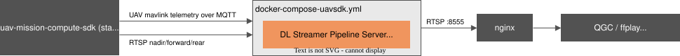
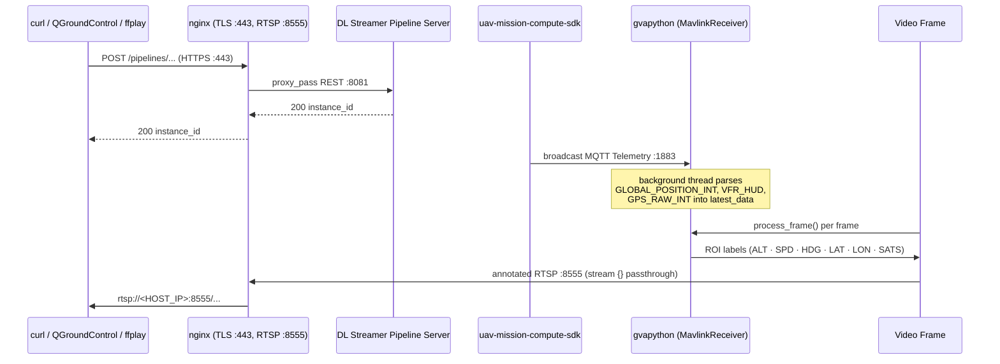

<!--
SPDX-FileCopyrightText: (C) 2026 Intel Corporation
SPDX-License-Identifier: Apache-2.0
-->

# Get Started (UAV Mission Compute SDK Mode)

This guide provides a step-by-step walkthrough for testing the UAV Vision Analytics application in UAV Mission Compute SDK mode and running the demo with a simulated UAV camera feed/RealSense cameras.

## How It Works

A minimal single-container stack. Telemetry is received via MQTT from the `uav-mission-compute-sdk` project, which must be started first. The DL Streamer Pipeline Server container reads armed/disarmed state from `uav/{id}/telemetry/status` and subscribes to three RTSP camera streams (nadir, forward, rear).



**Telemetry / pipeline lifecycle flow:**



**Services:**

| Service | Image | Ports | Role |
| --- | --- | --- | --- |
| `dlstreamer-pipeline-server` | `intel/dlstreamer-pipeline-server` | `8081`, `8555` | AI inference, RTSP output |
| `metrics-manager` (container `uav-metrics-manager`) | `intel/metrics-manager` | `9090` (internal; through nginx at `/metrics/stream` and `/api/v1/metrics/latest`) | CPU, GPU, NPU and memory metrics for the ground-station dashboard (the container is not named `metrics-manager`, which the SDK's observability profile uses) |
| `nginx` | `nginx:1.27-alpine` | `80` (redirects to 443), `443` (HTTPS, self-signed cert), `8555` (RTSP passthrough) — published to `HOST_IP` | Reverse proxy / TLS termination — the only service that publishes ports to the host |

> `dlstreamer-pipeline-server` no longer publishes ports directly — it is reachable only
> through `nginx` on the internal `app_network`.

---

## Steps to Test the Application

### Prerequisites

- Docker and Docker Compose v2
- Intel platform with at least 16 GB RAM (Panther Lake recommended)
- Network access to pull Docker images (configure proxy if behind a corporate firewall)
- The following system packages:

```bash
sudo apt install -y python3.12-venv ffmpeg
```

> `python3.12-venv` is required by `make model` to create a Python virtual environment.
> `ffmpeg` provides `ffplay` for viewing the RTSP output stream and `ffmpeg` for recording.

### 1. Start the UAV Mission Compute SDK

There are two options available to get the application source:

#### Option A — Download the ZIP (recommended)

Download the compressed file and get into the directory:

```bash
curl -OjL https://github.com/open-edge-platform/edge-ai-suites/releases/download/fedaero-latest/uav-mission-apps.zip
```

Decompress the downloaded file:

```bash
unzip uav-mission-apps.zip
cd  uav-mission-compute-sdk/
```

#### Option B — Clone the whole repository

Clone the repo, get into the directory and start the SDK's core infrastructure (PX4, MQTT broker, MediaMTX RTSP server).

```bash
git clone https://github.com/open-edge-platform/edge-ai-suites.git --branch main
cd edge-ai-suites/federal-and-aerospace-ai-suite/uav-mission-compute-sdk
```

Then, for either option, initialize the environment:

```bash
make init                # create .env, detect GPU
```

> Follow only **Step 0** (configure credentials) and **Step 1+2** (`make up-sim-camera`) from the [get-started guide](https://github.com/open-edge-platform/edge-ai-suites/blob/main/federal-and-aerospace-ai-suite/uav-mission-compute-sdk/docs/user-guide/get-started.md) / [SDK README](https://github.com/open-edge-platform/edge-ai-suites/blob/main/federal-and-aerospace-ai-suite/uav-mission-compute-sdk/README.md). Do **not** run `make apps` (SDK Step 3) — that starts the SDK's own AI vision-processor and dashboard, which is not needed here since `uav-vision-analytics` runs its own inference via DL Streamer Pipeline Server.

The SDK's `.env` defaults to `HOST_IP=127.0.0.1`, which binds MQTT, RTSP, and all other published ports to loopback only. Since `uav-vision-analytics` runs in a separate Docker container/network, it cannot reach loopback-bound ports. Set the SDK's `.env` to bind on all interfaces before starting it:

```bash
sed -i 's|^HOST_IP=.*|HOST_IP=0.0.0.0|' .env
make up-sim-camera        # start PX4, MQTT, RTSP server
```

### 2. Configure environment

If Downloaded Compressed file then Get into the directory with:

```bash
cd ../uav-vision-analytics/
```

Or, If Cloned whole repo then Get into the directory with:

```bash
cd edge-ai-suites/federal-and-aerospace-ai-suite/uav-vision-analytics
```

Then, for either option, initialize the environment:

```bash
make init
```

`make init` creates `.env` from the template and **auto-detects your Intel GPU device paths** (`GPU_DEVICE`, `GPU_RENDER_DEVICE`), **Intel NPU** (`NPU_DEVICE`), and **Intel RealSense / USB camera** (`CAMERA_DEVICE_1`). It skips if `.env` already exists.

Then set your host IP address in `.env`:

```bash
nano .env   # set HOST_IP=<your-machine-IP>
```

### 3. Prepare the model

Download and export the YOLO11s model to OpenVINO FP16 IR:

```bash
make model
```

> See the [AI Model guide](../how-to-customize/model-and-video-management/model.md) for model details.

### 4. Start the uav-vision-analytics application

The SDK's core infrastructure (step 1) must already be running.

```bash
cd edge-ai-suites/federal-and-aerospace-ai-suite/uav-vision-analytics
make uavsdk-up
```

### 5. Run a simple mission

> [!NOTE]
> Video streams are not available until the UAV is armed and actively on a mission.

Run the simple UAV mission in a persistent terminal window to keep the simulation active. The following sequence arms the UAV, commands a takeoff to 10 m, holds for 120 seconds, then lands:

```bash
curl -X POST http://localhost:8080/action/arm
curl -sf -X POST http://localhost:8080/action/takeoff \
  -H "Content-Type: application/json" \
  -d '{"altitude": 10}'
sleep 120
curl -X POST http://localhost:8080/action/land
```

### 6. Start inference pipelines

> Open a new terminal window and launch the inference pipeline to begin processing the video stream.

Two options are available depending on your use case:

#### Option A — Managed RTSP output (recommended)

Runs `pipeline_manager.py` inside the DL Streamer Pipeline Server container. It watches the SDK's MQTT status topic `uav/<UAV_ID>/telemetry/status` (`{"armed": true|false}`), starts the cameras of [`configs/cameras-uavsdk.yaml`](../../../configs/cameras-uavsdk.yaml) when the drone arms and stops them when it disarms. Annotated frames are served as RTSP on port `8555`.

The cameras are RTSP streams from the SDK (`rtsp://host.docker.internal:8554/<UAV_ID>/<camera>`, `UAV_ID` from `.env`, default `uav-1`). By default `nadir_camera` detects on the CPU, `forward_camera` on the GPU and `rear_camera` on the NPU (skipped when the host has no NPU). A camera whose RTSP source is not available is skipped. Edit the file to change the devices, switch on VLM captions or hide the overlay; it is read again at every arming. It has the same format as for the simulator, see [Configure the cameras](../how-to-customize/camera-management/configure-cameras.md).

```bash
make check-cameras      # validate cameras-uavsdk.yaml and show what would run
make start-rtsp         # wait for the drone to arm, then start the cameras
make cameras-status     # compare the file with what is running
```

**Captions.** With `captioning.enabled: true` on a camera, the captions are published to MQTT topic `uav/caption/<camera id>` on the
**SDK's broker** (`mqtt-broker`, host port `1884`), not on a broker of this stack: the compose file points the pipelines'
`MQTT_HOST`/`MQTT_PORT` at `host.docker.internal:1884`. Watch them with
`docker exec mqtt-broker mosquitto_sub -t 'uav/caption/#'`. The ground-station dashboard must use that port too
(`VIZ_REMOTE_MQTT_PORT=1884` in its `.env`; the default `1883` is the pymavlink stack's broker).

The streams are available only after the drone arms — see [Step 7 — View the output stream](#7-view-the-output-stream) for the RTSP URLs.

#### Option B — Manual REST API

> [!NOTE]
> RTSP streams are not available until the UAV is armed. Run a simple mission first (see [Step 5: Run a simple mission](#5-run-a-simple-mission)).

Start a single camera pipeline directly. The UAVSDK mode loads `config-uavsdk.json`, which has the same pipeline names as the simulator stack (`uav_object_detection_<det>` and `uav_object_detection_<det>_<vlm>`) with an RTSP source, taken from the `rtsp_url` parameter.

```bash
# Detection on the CPU for the nadir camera
INSTANCE_ID=$(curl -k -s -X POST \
  https://<HOST_IP>/pipelines/user_defined_pipelines/uav_object_detection_cpu \
  -H "Content-Type: application/json" \
  -d '{
    "destination": {"frame": {"type": "rtsp", "path": "uav-nadir-camera", "encoding": "h264"}},
    "parameters": {
      "rtsp_url": "rtsp://host.docker.internal:8554/uav-1/nadir",
      "detection_instance_id": "instcpu_yolo11s",
      "overlay_label": "nadir-CPU"
    }
  }' | tr -d '"')
echo "Instance ID: $INSTANCE_ID"

# Verify it reached RUNNING state (not ERROR)
curl -k -s https://<HOST_IP>/pipelines/${INSTANCE_ID}/status | python3 -m json.tool
```

If `state` is `ERROR`, check the container logs:

```bash
docker logs dlstreamer-pipeline-server 2>&1 | tail -20
```

To use another device change the pipeline name (`uav_object_detection_gpu`, `uav_object_detection_npu`, or the `_<vlm>` variants with `captioner_model_path` and `mqtt_topic` in `parameters`) and the `detection_instance_id`.

> [!NOTE]
> `https://<HOST_IP>/...` is the DL Streamer Pipeline Server REST API, proxied by nginx on
> port `443` (self-signed cert; use `curl -k` to skip verification). Plain HTTP on port `80`
> redirects to HTTPS. Replace `<HOST_IP>` with the value auto-detected by `make init` (see `.env`).

### 7. View the output stream

#### View with ffplay

Install ffmpeg first if not present using `sudo apt install ffmpeg`.

Any of the annotated streams can be viewed with `ffplay <RTSP_PATH>`:

```bash
ffplay rtsp://<HOST_IP>:8555/uav-nadir-camera      # nadir camera
ffplay rtsp://<HOST_IP>:8555/uav-forward-camera    # forward camera
ffplay rtsp://<HOST_IP>:8555/uav-rear-camera       # rear camera
```

#### Capture all the video streams

Record all three streams to disk with `ffmpeg`:

```bash
ffmpeg \
  -rtsp_transport tcp -i rtsp://<HOST_IP>:8555/uav-nadir-camera \
  -rtsp_transport tcp -i rtsp://<HOST_IP>:8555/uav-forward-camera \
  -rtsp_transport tcp -i rtsp://<HOST_IP>:8555/uav-rear-camera \
  -map 0:v -c:v copy nadir.mkv \
  -map 1:v -c:v copy forward.mkv \
  -map 2:v -c:v copy rear.mkv
```

The annotated stream includes bounding boxes for detected objects
(person, car, bus, truck, bicycle, and other classes)
and a live telemetry overlay (GPS, altitude, speed, heading).

> [!NOTE]
> Other ways to view the stream:
> - Leverage versatile streaming media players such as VLC Player to seamlessly handle, manage, and playback the incoming streams with ease and efficiency.

**Stop an individual pipeline** (only needed if you started one manually via Option B in [Step 6](#6-start-inference-pipelines)):

```bash
curl -k -X DELETE https://<HOST_IP>/pipelines/${INSTANCE_ID}
```

### 8. Stop all services

Stop and remove the uav-vision-analytics stack (also removes named volumes):

```bash
make uavsdk-down
```

Then stop the SDK's core infrastructure:

```bash
cd edge-ai-suites/federal-and-aerospace-ai-suite/uav-mission-compute-sdk
make down
```

---

## Pipelines

### UAV Mission Compute SDK Mode (`config-uavsdk.json`)

Nine pipelines with the same names as the simulator stack: `uav_object_detection_<det>` (`cpu`, `gpu`, `npu`) and `uav_object_detection_<det>_<vlm>` (`vlm` = `cpu` or `gpu`, with captions on MQTT `uav/caption/<camera>`). Their source is `rtsp_url`. `configs/cameras-uavsdk.yaml` picks them:

| Camera | Pipeline | Source (inside Docker) | Output RTSP (host) |
| --- | --- | --- | --- |
| `nadir_camera` | `uav_object_detection_cpu` | `rtsp://host.docker.internal:8554/<UAV_ID>/nadir` | `rtsp://<HOST_IP>:8555/uav-nadir-camera` |
| `forward_camera` | `uav_object_detection_gpu` | `rtsp://host.docker.internal:8554/<UAV_ID>/forward` | `rtsp://<HOST_IP>:8555/uav-forward-camera` |
| `rear_camera` | `uav_object_detection_npu` | `rtsp://host.docker.internal:8554/<UAV_ID>/rear` | `rtsp://<HOST_IP>:8555/uav-rear-camera` |

> `<UAV_ID>` is the `UAV_ID` environment variable (default: `uav-1`); set another value in `.env` if your SDK project uses a different vehicle ID. The cameras file uses the placeholder `{uav_id}`, so nothing else has to change.

All pipelines are `auto_start: false` — started by the manager (`make start-rtsp`) or through the REST API.

REST endpoint: `POST https://<HOST_IP>/pipelines/user_defined_pipelines/{name}` (proxied by nginx over HTTPS to `dlstreamer-pipeline-server:8081`)

---

## Telemetry Overlay Fields

Each output frame carries these overlaid fields in the upper-left corner:

| Field | Source MAVLink message | Description |
| --- | --- | --- |
| `Name` | — | Name passed as argument to the gvapython |
| `Frame` | — | Running frame counter |
| `ALT` | `GLOBAL_POSITION_INT.relative_alt` | Relative altitude (m) |
| `SPD` | `VFR_HUD.groundspeed` | Ground speed (m/s) |
| `HDG` | `GLOBAL_POSITION_INT.hdg` | Heading (degrees) |
| `LAT` | `GPS_RAW_INT.lat` | Latitude |
| `LON` | `GPS_RAW_INT.lon` | Longitude |
| `SATS` | `GPS_RAW_INT.satellites_visible` | GPS satellites visible |

---

## Port Reference

`nginx` is the only service that publishes ports to the host (bound to `HOST_IP`, not
`0.0.0.0`). `dlstreamer-pipeline-server` is reachable only on the internal `app_network`.

| Port | Protocol | Service | Published to host? | Mode |
| --- | --- | --- | --- | --- |
| `80` | HTTP | `nginx` → `301` redirect to HTTPS (no application traffic) | Yes | All modes |
| `443` | HTTPS | `nginx` → proxies to `dlstreamer-pipeline-server:8081` (REST API); self-signed cert, use `curl -k` | Yes | All modes |
| `8555` | RTSP | `nginx` → raw TCP passthrough to `dlstreamer-pipeline-server:8555` | Yes | All modes |
| `8081` | HTTP | DL Streamer REST API | No (internal only) | All modes |

---

## Documentation

| Document | Description |
| --- | --- |
| [index.md](../index.md) | Application overview and component block diagrams |
| [how-to-guides.md](../how-to-guides.md) | Operating the application: QGroundControl, ground station, deployment modes |
| [how-to-customize.md](../how-to-customize.md) | Changing cameras, models, pipelines, overlay and search tuning |
| [realsense-guide.md](../how-to-customize/camera-management/realsense-guide.md) | Intel RealSense camera setup and pipelines |
| [benchmark.md](../benchmark.md) | Performance benchmarking guide |
| [makefile.md](../how-to-guides/makefile.md) | Makefile target reference |
| [troubleshooting.md](../how-to-guides/troubleshooting.md) | Known issues and resolutions |
