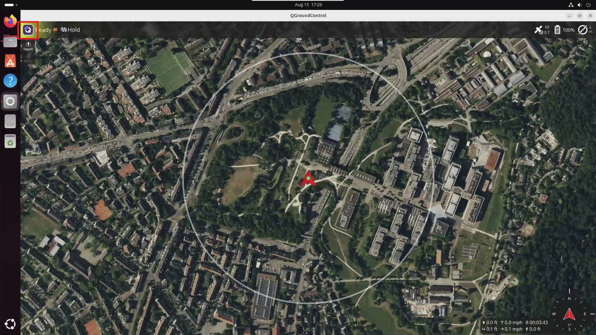

# QGroundControl

## Installation

Follow the instructions in the QGroundControl documentation to install
QGroundControl on your host machine where you are running the application.

- Stable v5.1: [Download and Install QGroundControl (Ubuntu)](https://docs.qgroundcontrol.com/Stable_V5.1/en/qgc-user-guide/getting_started/download_and_install.html#ubuntu)

> [!NOTE]
> If you run into connection or video-stream issues with the stable release, see
> [Troubleshooting: QGroundControl stable release fails to connect](./troubleshooting.md#qgroundcontrol-stable-release-fails-to-connect) for a fallback install option.

## Enabling video stream in QGroundControl

Steps to enable QGroundControl to connect to the UAV Vision Analytics application video stream.

### RTSP Stream

In QGroundControl, `Click on Left top Q icon` → `Settings` → `Video` → `Source`
→ `select "RTSP Video Stream"` in the dropdown. Then in RTSP URL enter the URL
for the desired pipeline.

URLs of the cameras (`rtsp://<HOST_IP>:8555/uav-<camera>`, one per camera of `configs/cameras-pymavlink.yaml`):

```text
rtsp://<HOST_IP>:8555/uav-front-camera    # one stream per camera of configs/cameras-pymavlink.yaml
rtsp://<HOST_IP>:8555/uav-bottom-camera
rtsp://<HOST_IP>:8555/uav-back-camera
```



> [!NOTE]
> Make sure `make start-rtsp` is running in the DL Streamer Pipeline Server container before
> attempting to connect QGroundControl to the RTSP stream.

## Connecting QGroundControl from another machine

`mavlink-router` exposes a UDP endpoint on `<HOST_IP>:14551` (bound to `HOST_IP` only,
like the other published ports). QGroundControl on a different machine does not
discover the vehicle automatically, so add a link:

1. In QGroundControl open `Q icon` → `Application Settings` → `Comm Links` → `Add`.
2. Set `Type` to `UDP`.
3. Under `Server Addresses`, click `Add Server` and enter `<HOST_IP>:14551`.
4. Save, select the new link, and click `Connect`.

QGroundControl sends its heartbeat first and the router learns its address, then
forwards telemetry to it and commands from it to PX4. Several stations can connect
at the same time. To use a different host port, set `MAVLINK_UDP_PORT` in `.env`
before `make pymav-up`.

> [!NOTE]
> The router's TCP server (port 5760) is disabled on purpose. With the router
> built into this stack it accepts a TCP connection but fails to send to it
> (`Error sending tcp packet (Invalid argument)`), so no data reaches the client.

> [!IMPORTANT]
> Anyone who can reach `<HOST_IP>:14551` can command the vehicle. Keep the host on a
> trusted network.

## Troubleshooting

- [QGroundControl — "Network Not Available" warnings](./troubleshooting.md#qgroundcontrol--network-not-available-warnings)
